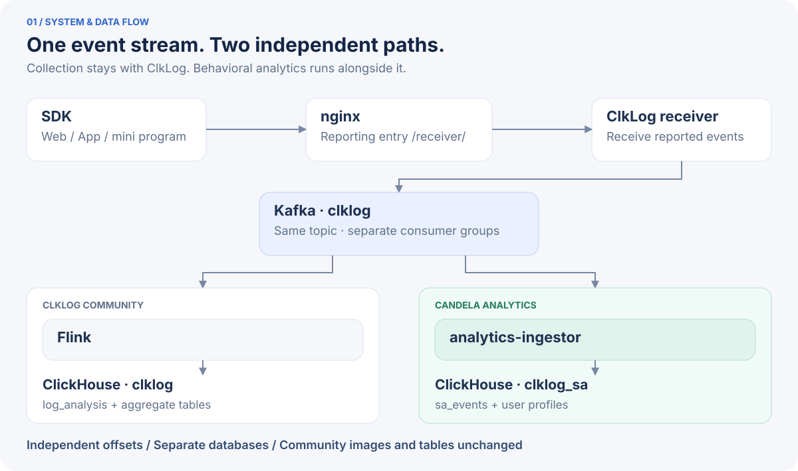
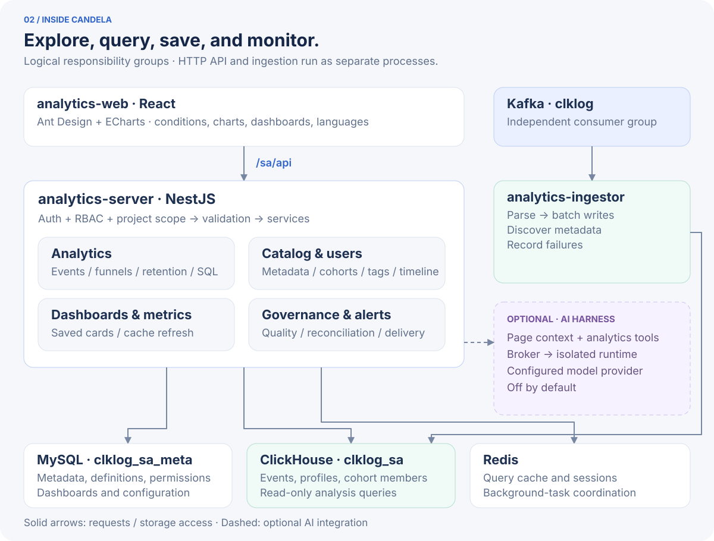

# Candela

**Turn user behavior into decisions.**

An open-source, self-hosted user-behavior analytics platform. Understand what users do, where they drop off, and whether they return—then track the changes with dashboards and alerts on your own server.

**Event analysis · Funnels · Retention · Cohorts · Dashboards & alerts**

**English** | [中文](README.zh-CN.md) · [AGPL-3.0](LICENSE) · [13 interface languages](#languages) · [Fully AI-written](#fully-ai-written-vibe-coding)

**[Quick start](#quick-start) · [Core features](#core-features) · [Product tour](#capabilities) · [Architecture](#architecture) · [Deployment guide](#deploy)**


*Save activity, conversion, revenue, and retention as reusable analysis cards. View, filter, and share them on a dashboard. Screenshots come from a running installation; some still show the earlier ClkLog branding. Dashboard and event names are user-defined.*

Built alongside **ClkLog Community Edition**: ClkLog handles collection and basic reports; Candela adds behavioral analytics, collaboration, and governance. Both consume the same Kafka event stream, with separate analytics databases. **Community images and table definitions stay unchanged.** The optional AI analysis assistant is off by default.

## Core features

| Your question | What Candela provides |
|---|---|
| What do users do, and which behaviors are growing? | **Event analysis**: counts, unique users, aggregations, property breakdowns, and trends |
| Where do users leave between signup and payment? | **Funnels**: step conversion, drop-off, and conversion windows |
| Do new users come back after a few days? | **Retention**: start and return events, daily cohorts, and retention trends |
| Which people need a closer look? | **Cohorts and timelines**: condition / SQL / ID cohorts, tags, and individual behavior |
| How can the team keep following the business? | **Dashboards, metrics, and alerts**: saved cards and notifications across channels |
| What if the standard analysis models do not cover my question? | **Custom SQL and optional AI**: read-only queries, charts, and analysis of the current page context |

A tracking catalog, data-quality checks, dimension tables, project-level permissions, and 13 interface languages support everyday use. Define your own events and properties for Web, App, mini-program, and other product analytics.

## Quick start

### 1. Prepare a server

This path uses a **single-server Docker Compose deployment**. Run the commands from the repository root on your workstation. You need:

- An **AlmaLinux 9** server with SSH key access as root; the recorded deployment was tested on AlmaLinux 9.6.
- Recommended **4 CPU cores / 16 GiB RAM / 40 GB or more disk**, with inbound port `80` open.
- Git, SSH, and rsync on the workstation; access to image registries, OS package repositories, and npm from the server. See [Prerequisites](#prerequisites) for mirror settings.

### 2. Deploy and verify

```bash
git clone https://github.com/ac1261692159/candela.git
cd candela
export HOST=root@your-server  # Replace with your SSH target

# In order: middleware → ClkLog standard mode → Candela
bash scripts/standalone-test-env/deploy-remote.sh mw
bash scripts/standalone-test-env/deploy-remote.sh clklog
bash scripts/standalone-test-env/candela/deploy-remote.sh docker

# Both suites must pass, including reporting and row-count checks
bash scripts/standalone-test-env/candela/deploy-remote.sh verify
bash scripts/standalone-test-env/deploy-remote.sh verify
```

The scripts install runtime components, build the applications, and initialize the databases. First-run time depends on downloads and builds. Steps are idempotent and can be repeated; AI setup is optional.

### 3. Log in and run your first analysis

Open **`http://<server-ip>/sa/`** and sign in as `admin`. The scripts generate the initial password on the target, in the `ADMIN_INIT_PASSWORD` entry of `/data/app/candela/configs/candela.env`. Read it in a controlled terminal on the target; do not commit or share that file. ClkLog Community is at `http://<server-ip>/`.

1. Select a project and open the **integration guide**. Follow its instructions for the endpoint, project identifier, and token; download an SDK example.
2. Run the example or send your own event. Confirm it arrives in **Debug**; first data may take time to appear.
3. Open **event analysis**, select an event, time range, and metric, then inspect the result.
4. Save the result as a **dashboard card**. Add a metric alert when you want ongoing monitoring.

SDK examples: [`examples/report-sdk/`](examples/report-sdk/). Protocol: [reporting specification](docs/architecture/reporting-protocol.md). The screenshots show example events and dashboards; connect your data to build your own analyses.

Already running ClkLog standard mode, need native processes, or want custom directories? See the [deployment guide](#deploy) and [deployment design](docs/architecture/candela-deploy-two-paths.md).

## Find your way

| Next step | Go to |
|---|---|
| Explore actual screens and feature details | [Capabilities](#capabilities) |
| Understand the data flow and internal responsibilities | [Architecture](#architecture) |
| Configure, upgrade, roll back, or troubleshoot | [Deploy](#deploy) · [Configuration and secrets](#configuration-and-secrets) |
| Develop locally or contribute | [Local development](#local-development) · [Repository layout](#repository-layout) · [Contributing](CONTRIBUTING.md) |
| Read about AI-written development | [Fully AI-written and CDD](#fully-ai-written-vibe-coding) |
| Take over the project or find design documents | [Documentation](#documentation) · [Handoff](docs/project/handoff-candela-new-repo.md) · [File index](INDEX.md) |

---

## Capabilities

Follow the workflow from reported events to analysis, cohorts, dashboards, and alerts. Click an image to inspect it at full size.

[Catalog](#tracking-catalog) · [Events](#event-analysis) · [Funnels](#funnel) · [Retention](#retention) · [Users](#users) · [Dashboards & SQL](#dashboards-sql-and-metrics) · [Data](#data-management) · [Alerts](#operations-and-alerts) · [Permissions](#access-control) · [AI](#ai-assistant)

### Tracking catalog

Reported events show up on their own. You do not register a name before the first event can be stored. The catalog is where you decide what analysts are allowed to pick.

- Each event has a display name, a description, an owner, and a status. Hiding an event removes it from the analysis pickers. The detail shows when it was first seen and how much volume it had recently.
- Event properties and user properties are sampled as they arrive: key, type, and an example value. You can correct the display name and the type (string, number, boolean, datetime, list).
- A virtual event is a saved event plus filters, such as "app checkout". After you name it, every analysis can pick it the way it picks a raw event.
- A virtual property is a saved expression over properties you already have. Analysis can filter, break down, and aggregate on it the same way as on a stored property.
- Notes sit on the event. Debug shows the latest raw events for a person or an event name, properties included, so you can confirm a new event landed before anyone builds a dashboard on it.


*Tracking catalog: confirm reported events and manage names, properties, and visibility.*

### Analysis

Use event, funnel, and retention models for aggregate analysis, or inspect an individual user’s timeline. Save analytical results as cards or export them as CSV; event analysis and retention slices can also define reusable metrics.

#### Event analysis

Put several metrics on one time range: count, unique users, sum, average, max, min, distinct count, a percentile, or a per-user rate. Filter on event properties and user properties, combined with and/or. Break the result down by a property, or by hour, day, week, or month. A formula combines metrics you already added. Approximate calculation is there when the scan is large. The result is a time series and a table.


*Event analysis: compare several metrics over the same time range.*

#### Funnel

2 to 32 steps. Each step is an event plus an optional filter. You set the window in which the steps must happen. The result is the overall conversion, the drop-off at each step, a funnel chart, and the step table.


*Funnel: follow conversion step by step and locate the largest drop-off.*

#### Retention

Pick a start event and a return event. They can be the same event or two different ones. Choose everyone who did the start event, or only people whose first day it was. The table is one row per cohort and one column per return day (day 1, day 7, day 30, or a day you add). A trend follows one of those columns across cohorts.


*Retention: compare daily cohorts and see whether people keep coming back.*

#### User timeline

Look a person up by a business attribute, without knowing the internal id. The page resolves them, lists their attributes, and shows the events in order, with the share of each event and the neighboring events around a row.

Every analysis has a subject, the unit you are counting. The preset subject is the user. A project can add others.


*User timeline: move from an aggregate number to one person’s behavior.*

### Users

Cohorts and tags are saved sets of people. Once saved, analysis and dashboards can filter or break down by them.

- A condition cohort is a sentence: did this event, did not, did these events in order, or matches these user properties, inside a time window. It can recalculate on a schedule or only when you refresh it.
- An ID cohort is a CSV of user ids.
- A SQL cohort is a query that returns the people.
- A result cohort is the set of people behind a count in an event, funnel, or retention result, saved as a snapshot.
- Tags are another way to mark the same people and reuse the mark.
- Analysis subjects define who "a person" is for that project, when the preset user is the wrong unit.

### Dashboards, SQL, and metrics

A dashboard is a grid. Cards drag and resize. A card remembers the analysis that produced it (event, funnel, retention, or SQL) and refreshes from cache, with background warm-up so the board is not empty on open. A cohort filter on the board narrows the cards together.

Charts on a card are line, bar, pie, donut, a single number, or a funnel.

Custom SQL is for the question the three models do not cover. You can write SQL or use the builder. A dictionary beside the editor lists events, event properties, user properties, system fields, and cohorts. The query runs as a read-only account. The result can be a table or a chart, and it can be saved as a card.

A metric is a saved definition, taken from an event-analysis result or a retention slice. You reuse it in a later query instead of rebuilding the filters, and you can alert on it.

### Data management

- Dimension tables are CSV or Excel files you upload: confirm the columns, preview the rows, then bind a column to an event property so a query can join them. Each upload keeps a versioned snapshot.
- Data quality compares what you registered with what actually arrived: type mismatches, unknown properties, missing required values.
- Consistency reconciliation checks the analytics store against the community event log.
- Partition cleanup, TTL, and log-directory governance are how the stored events and logs stay bounded.
- The integration guide is the page that explains how to send events in.

### Operations and alerts

The ops console is for the person running the machine: slow SQL, host status, and a disk forecast.

Alerts cover both the product and the machine. A metric alert fires when a saved number crosses a threshold. Built-in rules watch slow queries, query failures, card-cache failures, ClickHouse availability, free disk, and a stale ingest path. A rule has a severity, a window, how long the condition must hold, and how often to repeat the message while it is still firing.

Delivery goes through Feishu, DingTalk, WeCom, a generic webhook, email, SMS (Alibaba Cloud, Tencent Cloud, AWS, Twilio), Telegram, and WhatsApp. Message text comes from a template. You can mute a channel, retry a failed delivery, and send a test message. Each rule shows a health state, and changes are written to a log.


*Alert channels: choose the notification services your team uses.*

### Access control

A platform admin runs the installation: projects, the ops console, and who owns a project. Inside a project the roles are project owner, analysis admin, analyst, member, and external. People can also be placed in member groups, and a grant can target the group.

A data policy limits which events, event properties, and user properties a member can see, and can add a row filter. The limit is applied when the query runs.

Dashboards live in folders. A folder, dashboard, card, cohort, or tag can be locked so its definition stops changing, or shared with specific people for view or edit.

### AI assistant

An assistant sits beside the analysis you already have open. It can read the current page (the query, the time range, the result) and answer from that, or run a tool call. You configure model providers yourself; the workspace templates can be synced from the product.

It is **off by default**. Turning it on needs the Harness runtime and a provider key. See [Configuration and secrets](#configuration-and-secrets).


*Custom SQL with optional AI: follow up on the current query result. The assistant requires additional setup.*

### Languages

The interface, errors, exports, and notification text ship in 13 languages: simplified Chinese, traditional Chinese, English, Japanese, Korean, Russian, French, German, Spanish, Portuguese, Vietnamese, Thai, and Indonesian. The language follows the signed-in user. Names you created (events, dashboards, notes, SQL) stay as you wrote them.

CI checks that every language has the same keys, and that new interface text is not hardcoded.

[Back to navigation](#find-your-way)

---

## Architecture

### System and data flow

Each reported batch enters Kafka and is handled by **two independent consumer paths**. Community Flink writes the community ClickHouse database. Candela ingestor uses its own consumer group to write analytics events and user profiles. Candela event ingestion comes directly from Kafka.



Community images and tables remain unchanged. Candela can read community data for consistency checks; the two consumers progress independently. **ClkLog standard mode is required**: quick mode skips Kafka and cannot provide the event stream to Candela.

### Inside Candela

The web app builds analysis conditions and presents results. The backend handles authentication, project isolation, query execution, and business management. The diagram groups logical responsibilities; source modules define the actual boundaries.



| Part | Responsibility |
|---|---|
| **Web** | React + Ant Design + ECharts; analysis conditions, charts, dashboards, languages, and page context |
| **HTTP API and business modules** | NestJS; authentication and project permissions, event / funnel / retention / SQL queries, catalog, users, dashboards, governance, and alerts |
| **Ingestor** | Separate Kafka consumer process; event and profile parsing, batch writes, metadata discovery, and failure records |
| **MySQL** | Metadata, analysis definitions, dashboards, permissions, and platform configuration (`clklog_sa_meta`) |
| **ClickHouse** | Events, profiles, cohort and tag membership (`clklog_sa`); custom SQL uses `sa_readonly` |
| **Redis** | Query and dashboard caches, sessions, and background-task coordination |
| **Optional AI Harness** | Broker-managed isolated runtimes, authorized page context, and analytics tools; requires runtime installation and a model provider |

After ingestion, event and property metadata are discovered automatically. Analysis runs within the caller’s project and permissions. Results can become dashboard cards; background work refreshes caches and evaluates alerts.

<details>
<summary>Deployment components and default ports</summary>

| Component | Role | Port (default) |
|---|---|---|
| Host nginx | Single entry, path-based routing (no domain; reach it by IP) | `80` |
| MySQL 8 | Community database `clklog` plus platform metadata `clklog_sa_meta` | `127.0.0.1:3306` |
| Redis 7 | Community cache plus platform query cache and sessions (key-prefix isolation) | `127.0.0.1:6379` |
| Kafka 3.7 (KRaft) | Ingest messages, topic `clklog` (6 partitions) | `127.0.0.1:19092` |
| ClickHouse 23.2 | Community database `clklog` plus platform database `clklog_sa` (writer `default`, reader `sa_readonly`) | `8123` / `9000` |
| Community apps | `clklog-ui` / `receiver` / `api` / `manage` / `init` plus Flink `jobmanager` / `taskmanager` | 127.0.0.1:8081–8085 |
| Analytics platform | `analytics-server` (HTTP) / `analytics-ingestor` (Kafka consumer) / web static files | `127.0.0.1:3100` (native) / `:3100` + `:8086` (containers) |

</details>

[Back to navigation](#find-your-way)

---

## Deploy

Deploy the three layers in order: **middleware → ClkLog Community → analytics platform**. Every script is **idempotent and safe to re-run**. There is no CI/CD requirement: the workstation rsyncs the source to the target, and the target builds it.

> Verified end to end on **AlmaLinux 9.6 / 4 cores / 15 GiB RAM / 92 GB disk**: middleware and community 12/12, native analytics 18/18, container analytics 19/19. Re-running either analytics path produced zero drift.
> Scripts live in `scripts/standalone-test-env/`. Design: [`docs/architecture/standalone-test-env-design.md`](docs/architecture/standalone-test-env-design.md) and [`docs/architecture/candela-deploy-two-paths.md`](docs/architecture/candela-deploy-two-paths.md). Evidence: [middleware and community deployment](docs/project/deployment-record-standalone-test-env.md), [Candela deployment](docs/project/deployment-record-candela-two-paths.md).

### Prerequisites

| Item | Requirement |
|---|---|
| Target | AlmaLinux 9 (RHEL 9 family is the same), root login, inbound `80` open (optional `8123` if clients should reach ClickHouse directly) |
| Workstation | SSH to the target with key auth already set up (the scripts `ssh` and `rsync` the source, then run remotely) |
| Software | The scripts install Docker and nginx. The native path also needs EPEL (the script configures it; the machine must be able to reach an EPEL mirror) |
| Network | Must be able to pull images. Base images come from `public.ecr.aws/docker/library/*`. ClkLog images come from `registry.cn-shanghai.aliyuncs.com/clklog/*` |
| Capacity | At least 4 cores and 16 GiB is the recommendation (15 GiB has been shown to work). Memory caps are set explicitly for a small machine |
| Disk | At least 40 GB (images are about 2 GB; the rest is ClickHouse data and logs) |

Two default deploy roots: Candela scripts accept `BASE_DIR` / `MW_BASE_DIR`; the middleware and community remote entry accepts `BASE_DIR` for its own root.

- `<MW_BASE_DIR>` = `/data/clklog-oss-test` — middleware and community (data, config, secrets, scripts)
- `<BASE_DIR>` = `/data/app/candela` — analytics platform (releases, config, secrets, image recipes)

> On a machine outside China, or behind a proxy, override `APT_MIRROR=` (empty uses the image's own Debian mirrors), `NPM_REGISTRY=https://registry.npmjs.org`, `NODE_IMAGE=`, and `NGINX_IMAGE=`.
>
> ClkLog Community images are pulled from `registry.cn-shanghai.aliyuncs.com/clklog/*` by default. If that registry is unreachable, use a proxy, or mirror the images and change `CK_REG` in the deploy scripts. Official base images come from `public.ecr.aws/docker/library/*`.

---

### Step 1: Deploy middleware

MySQL, Redis, Kafka (KRaft), and ClickHouse, all in containers. Data lands in `<MW_BASE_DIR>/data/`. The script generates random passwords (32 hex characters) and writes them only on the target, in `<MW_BASE_DIR>/config/deploy.env` (mode 0600). It also creates the shared network `clklog-net` and the topic `clklog`.

The script does not pick a machine for you. Pass the SSH target every time:

```bash
# From the workstation, at the repository root
export HOST=root@your-server
bash scripts/standalone-test-env/deploy-remote.sh mw
```

To use another middleware directory (apply the same `BASE_DIR` to the community deploy and verification commands, then pass it as `MW_BASE_DIR` to Candela):

```bash
HOST=root@your-server BASE_DIR=/data/mw bash scripts/standalone-test-env/deploy-remote.sh mw
```

When it finishes: 4 containers healthy, community MySQL schema in place, Kafka topic ready. Container names and ports are in the [Architecture](#architecture) table.

---

### Step 2: Deploy ClkLog Community

Deploys Community 1.3.0 in **standard mode** (`receiver → Kafka → Flink → ClickHouse`) and adds a single-host nginx entry (path routing, no domain).

```bash
HOST=root@your-server bash scripts/standalone-test-env/deploy-remote.sh clklog
```

> **Standard mode is required.** Candela ingestor consumes events independently from the same Kafka topic; community ClickHouse data is used for read-only queries and checks. Quick mode (receiver writes ClickHouse directly and skips Kafka) gives the platform nothing to consume.

---

### Step 3: Deploy the analytics platform (two ways)

Both paths **share the database init scripts, config rendering, and secret contract**. They differ only in how the process is started: native runs on the host, containers run in Docker. They are **mutually exclusive** (both bind `:3100` and the `/sa/` route). Switching stops the other path automatically.

#### Path A: native (host Node + supervisord)

Versioned releases (`releases/<timestamp>` plus `current` / `previous` symlinks, so switch and rollback are atomic). Supervisord runs `analytics-server` and `analytics-ingestor`. Host nginx serves the web build.

```bash
HOST=root@your-server bash scripts/standalone-test-env/candela/deploy-remote.sh native
```

Flow: install Node 24.20.0 (SHA256 checked) → install supervisord (EPEL) → build server and web (Prisma Client is generated **at build time**, so startup does not need the npm registry) → assemble the release (including precompressed gzip) → atomic switch → initialize databases → write supervisor programs → configure nginx → readiness check.

#### Path B: Docker Compose

Three images (`analytics-server`, `analytics-web`, and a one-shot `manager-migrate`). Stack name `candela`, joined to the middleware network `clklog-net` (containers address `mysql`, `redis`, `kafka`, and `clickhouse` by service name).

```bash
HOST=root@your-server bash scripts/standalone-test-env/candela/deploy-remote.sh docker
```

Images are tagged by content hash. Unchanged source and Dockerfiles reuse the existing image (a re-run does nothing). Rollback means setting `DOCKER_*_TAG` in `<BASE_DIR>/configs/candela.env` back to the previous tag, then running `docker --skip-build`.

<details>
<summary>Database initialization details</summary>

#### Database initialization (shared, runs automatically)

No manual SQL:

- **MySQL:** creates `clklog` (community) and `clklog_sa_meta` (platform metadata); creates the least-privilege account `clklog_sa_app` (granted only on the metadata database; the app does not use root); builds metadata tables from `prisma/schema.prisma` as a **baseline**, records migration history, then **replays the idempotent seeds** inside the migrations (built-in alert rules, log-governance allowlist, retention policy, project row); finally creates the superuser `admin`.
- **ClickHouse:** creates `clklog_sa` and 4 core tables (`sa_events`, `sa_user_profiles`, `sa_cohort_members`, `sa_tag_members`), skip indexes, and the cleanup infrastructure (`clklog_sa_bak`, `clklog_sa_staging`, `sa_cleanup`); writes the read-only account `sa_readonly` (`readonly=2` profile plus embedded grants, `SELECT` only on `clklog_sa.*` and `clklog.*`, separate from the writer).
- Either script can be run alone: `init-db-mysql.sh --runner host|docker` and `init-db-clickhouse.sh --runner host|docker` (under `scripts/standalone-test-env/candela/`).

> If the metadata database already has a **usable** migration history, the path is incremental `prisma migrate deploy`. A baseline rebuild (which empties the metadata database and says so) runs only when there is no history, or the history contains a failed record. See [`docs/architecture/candela-deploy-two-paths.md`](docs/architecture/candela-deploy-two-paths.md) §3 and §5.

</details>

### Access and verification

| Entry | URL | Account |
|---|---|---|
| Analytics platform | `http://<target-ip>/sa/` | `admin` / `ADMIN_INIT_PASSWORD` in `<BASE_DIR>/configs/candela.env` on the target (generated at deploy time) |
| ClkLog Community | `http://<target-ip>/` | `admin` / `clklog` (community seed account; change it after login) |

One-shot verification. The script detects whether the current install is native or containers:

```bash
HOST=root@your-server bash scripts/standalone-test-env/candela/deploy-remote.sh verify   # analytics (native: 18; Docker: 19; +3 with AI Harness)
HOST=root@your-server bash scripts/standalone-test-env/deploy-remote.sh verify           # middleware + community (12 checks)
```

Coverage: process or container state, HTTP entry, MySQL tables and the superuser, ClickHouse tables and a proof that `sa_readonly` cannot write, Kafka consumer-group lag, the **end-to-end ingest path** (report through the receiver, then both community `log_analysis` and platform `sa_events` row counts increase), and the platform login API. A machine with the Harness runtime also checks the broker process, the socket health probe, and that the switch matches.

<details>
<summary>Operations: redeploy, roll back, clean up, and troubleshoot</summary>

### Day-to-day operations

```bash
export HOST=root@your-server
M=scripts/standalone-test-env/candela/deploy-remote.sh

bash $M push            # push the latest source and scripts, do not deploy
bash $M native          # redeploy (idempotent: unchanged content reuses the release and skips the restart)
bash $M docker          # same, container path

# Rollback
#   Native: point current back at the previous symlink, then restart supervisor (the script prints the exact command)
#   Containers: restore the previous DOCKER_*_TAG, then bash $M docker --skip-build

bash $M wipe            # drop databases only (dry-run by default; prints what would be deleted)
bash $M wipe --yes      # actually drop them, then recreate environment resources (Kafka topic, community ClickHouse tables)

# Wipe the whole install (containers, images, volumes, data dirs, config, Node) back to "infrastructure only":
HOST=root@your-server bash scripts/standalone-test-env/deploy-remote.sh teardown        # dry-run
HOST=root@your-server bash scripts/standalone-test-env/deploy-remote.sh teardown --yes  # real delete; secret files go with it, and the next deploy generates new passwords

# Troubleshooting
supervisorctl status candela_server candela_ingestor   # native
docker compose -f /data/app/candela/docker/docker-compose.yml ps  # containers
docker logs -f candela-server
tail -f /data/logs/production/candela/analytics-server.log
```

</details>

[Back to navigation](#find-your-way)

---

## Configuration and secrets

- **Secrets stay off the repo and out of logs.** Deploy scripts generate every random password and write it only on the target, in `<BASE_DIR>/configs/candela.env` (mode 0600). Middleware passwords live in `<MW_BASE_DIR>/config/deploy.env`. Do not commit either file, and do not send them out.
- **Where config comes from.** The running platform config is `<BASE_DIR>/configs/config.yaml`, **rendered** by the deploy script from `apps/analytics-server/config_server.yaml`. The render changes only deploy-time values (database, Redis, and Kafka addresses, and the Harness switch), and **each substitution asserts how many times it must match**. If the repo config changes shape, the script fails instead of silently mismatching. Do not hand-edit `config.yaml` on the target (the next deploy overwrites it; change the source file in the repo).
- The app reads that YAML through `APP_CONFIG_PATH`. `${VAR}` placeholders are filled from the env file.
- **The AI assistant is off by default** (`deepseek_harness.enabled: false`). Turning it on needs the Harness runtime (rootless podman plus a broker) and a model-provider key (added in the product under Settings → AI Workspace → model providers; the key is stored as AES-256-GCM ciphertext). Read [`docs/architecture/clklog-ai-workspace-design.md`](docs/architecture/clklog-ai-workspace-design.md) first. On a test machine: `bash <BASE_DIR>/ops/candela/install-harness.sh` (idempotent; writes the `<BASE_DIR>/configs/harness.enabled` marker), then redeploy once (`HARNESS_ENABLED=1 bash deploy-native.sh --skip-build`) so the switch settles on `true`. Design and acceptance: [`docs/architecture/standalone-test-env-harness-design.md`](docs/architecture/standalone-test-env-harness-design.md).
- **Read-only isolation.** Custom SQL and AI queries use `sa_readonly` (config key `READONLY_CH_PASSWORD`). The writer account `default` is only for the platform's own sidecar writes.

[Back to navigation](#find-your-way)

---

## Local development

Use Node 24 and reachable MySQL, ClickHouse, Redis, and Kafka instances. Set up connections using [Configuration and secrets](#configuration-and-secrets), then open three terminals at the repository root:

```bash
# Terminal 1: backend HTTP :3100
cd apps/analytics-server
npm ci
npx prisma generate
npm run start:dev
```

```bash
# Terminal 2: independent Kafka consumer
cd apps/analytics-server
npm run start:ingestor:dev
```

```bash
# Terminal 3: web Vite :8180, proxies /sa/api → :3100
cd apps/analytics-web
npm ci
npm run dev
```

Open `http://localhost:8180/sa/`. Run tests and gates from the repository root:

```bash
(cd apps/analytics-server && npm test)
(cd apps/analytics-web && npx vitest run)
python3 scripts/arch_ratchet.py
python3 scripts/i18n_check.py
python3 scripts/i18n_scan.py --check
```

Middleware setup: [Deploy](#deploy). Public checks: [`.github/workflows/ci.yml`](.github/workflows/ci.yml). The GitLab build template is [`scripts/gitlab-ci.yml.template`](scripts/gitlab-ci.yml.template); fill in your own runner tags and target hosts.

[Back to navigation](#find-your-way)

---

## Repository layout

```
apps/
  analytics-server/         NestJS server: HTTP API + Kafka ingestor + Prisma + ClickHouse access
  analytics-web/            React + Vite web app (13 languages)
  analytics-harness-broker/ AI Harness runtime manager (optional)
  analytics-harness-host/   In-container AI runtime host (optional)
scripts/
  standalone-test-env/      Deploy scripts: middleware + community
    candela/                Deploy scripts: analytics (native and container paths, database init, wipe, verify)
  build.sh and others       CI build and operations scripts
deploy-assets/
  clklog-community/         Config assets copied from the official ClkLog deploy package
                            (init SQL, ui config.js, dictionaries)
                            — the data source for both community and analytics deploy scripts
docs/
  product/                  PRDs (product hat)
  architecture/             Implementation plans and contracts (architecture hat)
  project/                  Schedule, acceptance records, retrospectives (project hat)
examples/report-sdk/        Ingest SDK examples (several languages)
```

[Back to navigation](#find-your-way)

---

## Fully AI-written (vibe coding)

**The application code in this project is 100% AI-written.** People set goals, accept results, and make decisions; models from different vendors take turns on the same repository. The project uses **CDD (Charter-Driven Development)**: persistent repository rules, design documents, and executable checks support handoffs and verification.

[`AGENTS.md`](AGENTS.md) is the source of agent working rules; [`INDEX.md`](INDEX.md) maps tasks to files. Each session can reload role boundaries, architecture red lines, and acceptance requirements. Read the full argument in [CDD methodology](CDD-methodology.md) ([中文](CDD-methodology.zh-CN.md)).

<details>
<summary>Participating models and engineering method</summary>

| Model | Client | Share |
|---|---|---|
| DeepSeek V4.0 / V4.1-Flash | ZCode | ~80% |
| Grok 4.5 | Cursor | ~12% |
| GLM 5.3-Flash | ZCode | ~5% |
| GPT-5.6 Sol | Codex | ~3% |

These are rough shares recorded by the original project. The repository rules define the engineering constraints; checks cover structure, translation resources, and hardcoded text, while deployment acceptance covers reporting and database writes end to end. Design and acceptance evidence are linked under [Documentation](#documentation).

</details>

[Back to navigation](#find-your-way)

---

## Documentation

| If you want | Read |
|---|---|
| Development method (Charter-Driven Development / CDD) | [`CDD-methodology.md`](CDD-methodology.md) · [中文](CDD-methodology.zh-CN.md) |
| This README in Chinese | [`README.zh-CN.md`](README.zh-CN.md) |
| Status and milestones | [`docs/project/project-status.md`](docs/project/project-status.md) |
| File index (task → file) | [`INDEX.md`](INDEX.md) |
| Deploy-script design | [`docs/architecture/standalone-test-env-design.md`](docs/architecture/standalone-test-env-design.md), [`docs/architecture/candela-deploy-two-paths.md`](docs/architecture/candela-deploy-two-paths.md) |
| Deploy evidence | [`docs/project/deployment-record-standalone-test-env.md`](docs/project/deployment-record-standalone-test-env.md), [`docs/project/deployment-record-candela-two-paths.md`](docs/project/deployment-record-candela-two-paths.md) |
| Containers / Kubernetes / Helm feasibility | [`docs/architecture/containerization-feasibility.md`](docs/architecture/containerization-feasibility.md) |
| Overall analytics plan and contracts | [`docs/architecture/analytics-extension-plan.md`](docs/architecture/analytics-extension-plan.md), [`docs/architecture/clklog-analytics-design.md`](docs/architecture/clklog-analytics-design.md) |
| Contributing / security reports | [`CONTRIBUTING.md`](CONTRIBUTING.md), [`SECURITY.md`](SECURITY.md) |
| Old production runbook | Withdrawn. [`docs/project/legacy-production-handover.md`](docs/project/legacy-production-handover.md) only explains why |
| Internationalization (glossary / adding a language) | [`docs/architecture/i18n-glossary.md`](docs/architecture/i18n-glossary.md) |
| Ingest protocol and SDKs | [`docs/architecture/reporting-protocol.md`](docs/architecture/reporting-protocol.md), [`examples/report-sdk/`](examples/report-sdk/) |

[Back to navigation](#find-your-way)

---

## Names and boundaries

Candela is the SI unit of luminous intensity. The project was renamed from `clklog_manager` to Candela on 2026-10-10.

| Name | Means | Notes |
|---|---|---|
| **Candela** | **This project / the analytics platform** | The repository, images (`candela-server`, `candela-web`, `candela-migrate`), containers (`candela-server` and the rest), the compose stack (`candela`), the deploy directory (`/data/app/candela`), supervisor programs (`candela_server`, `candela_ingestor`), and the product brand (title, wordmark, email signature) |
| **ClkLog** | **The upstream community edition** (collection and basic reports) | Official images, community containers (`clklog-receiver`, `clklog-api`, `clklog-manage`, `clklog-ui`, `clklog-init`, Flink), community databases (MySQL `clklog`, ClickHouse `clklog`), and the ingest protocol and SDK (`ClkLogClient`, `CLKLOG_ENDPOINT`, `CLKLOG_TOKEN`, `CLKLOG_PROJECT`). **These names stay as they are.** They point at the upstream protocol and components; renaming them would break the examples in the integration docs |
| `sa` **technical identifiers** | Historical internal identifiers | The path `/sa/`, the API prefix `sa/api`, database names `clklog_sa` and `clklog_sa_meta`, the read-only account `sa_readonly`, environment variables `CLKLOG_*`, and `clklog_sa.` plus `sa_in_cohort()` inside saved SQL. They are fixed in nginx routes, the web build base, the Prisma datasource, ClickHouse DDL, and analysis configs users have already saved. **Moving them is expensive and would break old links and old cards**, so that rename is its own phase (keep the old path working, then switch). It is out of scope for the brand rename |

**Why the name does not include ClkLog.** This project is a sidecar and a private-deploy layout on top of ClkLog Community. Putting the upstream name in the brand makes it easy to mistake the project for an official ClkLog product, and it crosses the upstream trademark line. The brand stands alone. README and `NOTICE` are where we say it is built on ClkLog Community Edition.

[Back to navigation](#find-your-way)

---

## License and upstream attribution

This project is released under the **GNU Affero General Public License v3.0** (AGPL-3.0, SPDX: `AGPL-3.0-only`). The full text is [`LICENSE`](LICENSE). Copyright is held by the natural person huzhengkun. Model-assisted writing does not change that license.

**Upstream.** This project is a sidecar and a private-deploy layout for [ClkLog](https://www.clklog.com/) Community Edition (AGPL-3.0). The repository contains configuration files copied or adapted from the official deploy package. Upstream components, images, and the per-file change list are in [`NOTICE`](NOTICE). This project **does not modify community images or table definitions**. The analytics domain lives entirely in its own databases (`clklog_sa` and `clklog_sa_meta`).

**Network use.** AGPL-3.0 §13 requires that if you offer this software as a network service, you give those users a way to obtain the corresponding source. Anyone who runs this project as a service is responsible for that obligation.
