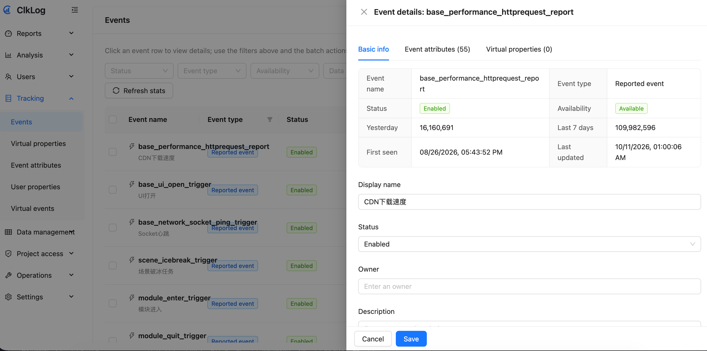
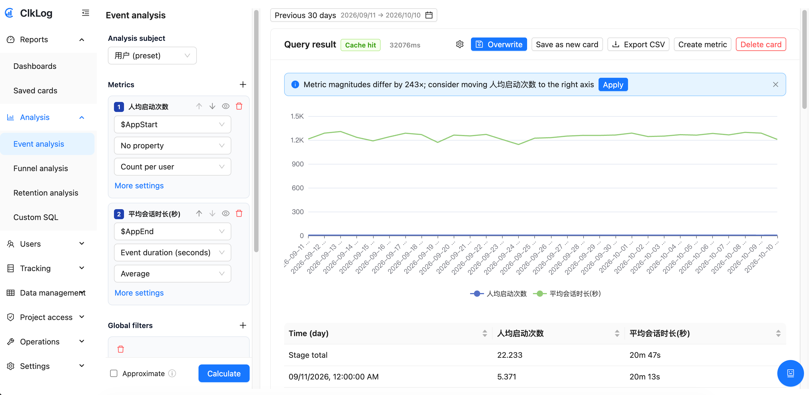
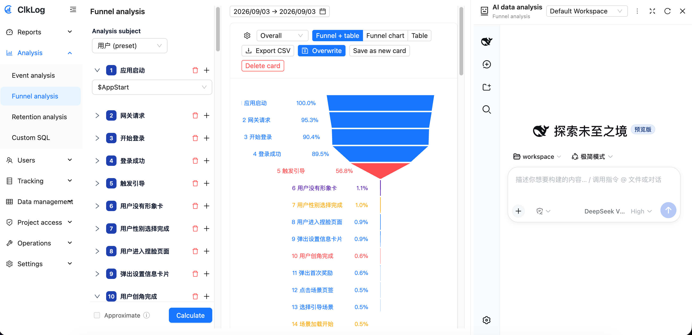
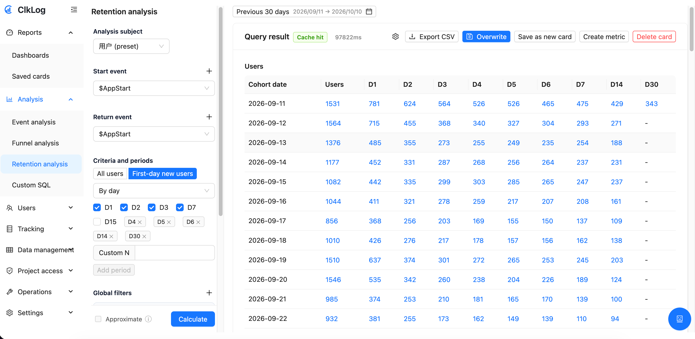
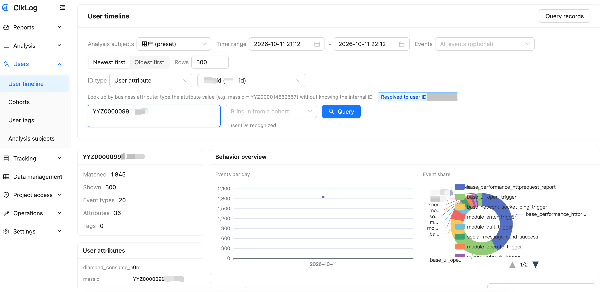
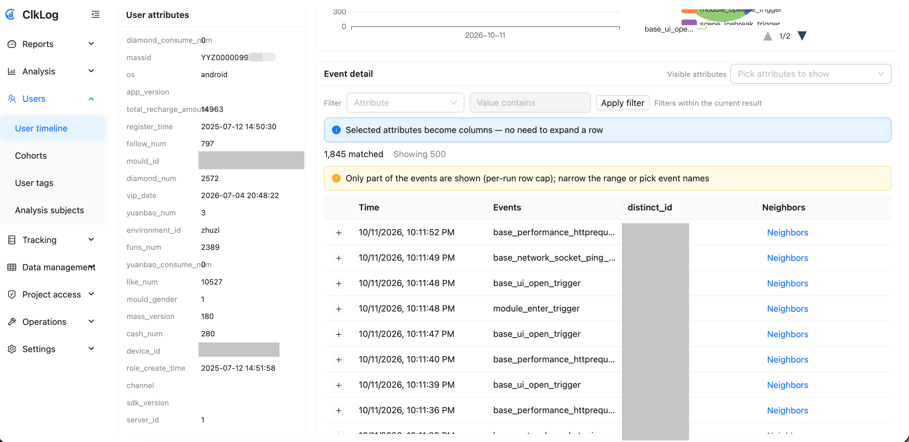
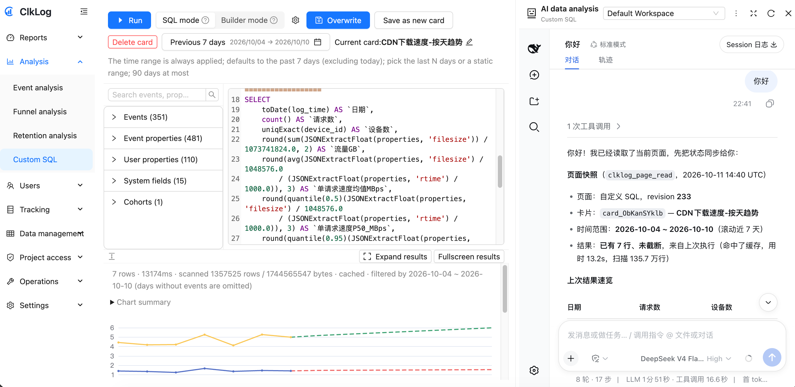
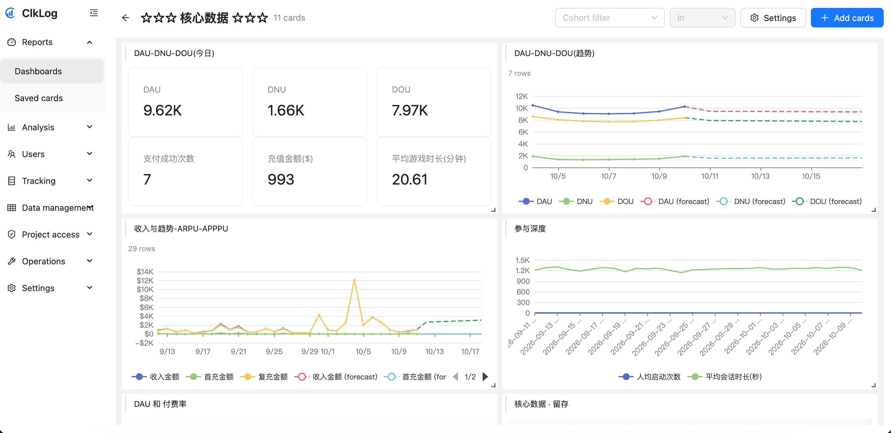
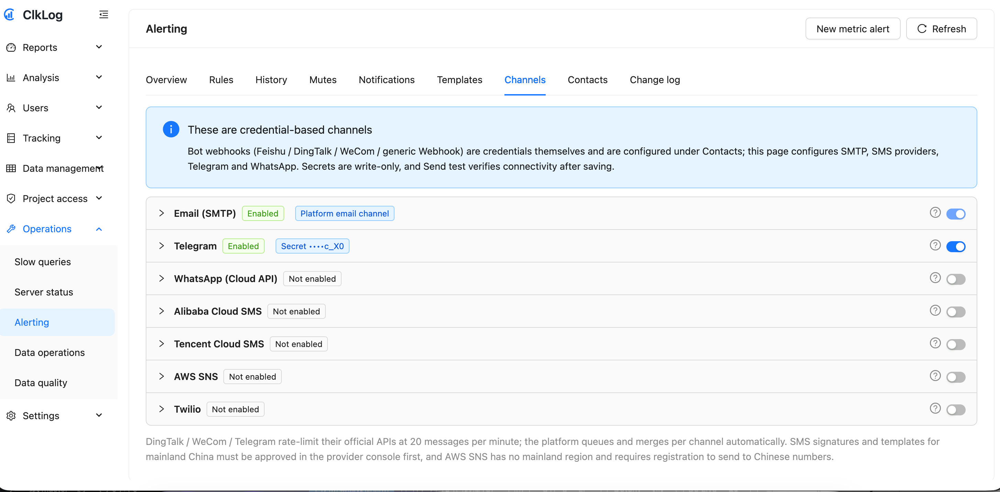

# Candela

[English](README.md) | **中文**

[CDD methodology](CDD-methodology.md) · [宪章驱动开发](CDD-methodology.zh-CN.md)

> **全 AI 编写（Vibe Coding）**：本项目 **100% 由 AI 编写**——没有人类手写业务代码，人只负责定目标、验收与拍板；同一份代码库由多个厂商的模型接力产出，靠 [`AGENTS.md`](AGENTS.md) 的规则与架构约束保持可控与质量。详见下方 [全 AI 编写](#全-ai-编写vibe-coding)。

**开源、可私有化的用户行为分析平台** —— 跑在 ClkLog 社区版之上，把原始埋点变成可度量、可追问、可告警的洞察。
把该项目直接通过AI agent 打开（如cursor,codex,zcode等），无需多言，ai什么都懂！

> Candela 是**发光强度**的国际单位：我们把用户行为「点亮」成可度量的数。项目原先叫 `clklog_manager`，2026-10-10 更名为 Candela；命名边界见下文「[命名与边界](#命名与边界)」。

在 ClkLog 社区版（数据采集与基础报表）之上旁路扩展出一个完整的分析平台：事件分析、漏斗、留存、用户分群与标签、看板、自定义 SQL 与图表、指标与告警、项目级权限（RBAC）、多语言界面、AI 数据分析助手。分析域使用独立数据库（MySQL `clklog_sa_meta` + ClickHouse `clklog_sa`），**不修改社区版镜像、不 ALTER 社区版表**，因此官方升级不受影响。

- 许可：AGPL-3.0（见 [`LICENSE`](LICENSE)），上游归属见 [`NOTICE`](NOTICE)
- **接手/交接入口**：[`docs/project/handoff-candela-new-repo.md`](docs/project/handoff-candela-new-repo.md)（仓库来源、目标机现状、待办与已知坑）
- 阶段进展与设计速览：[`docs/project/project-status.md`](docs/project/project-status.md)
- 文件导航：[`INDEX.md`](INDEX.md)

---

## 目录

- [能管理什么、能分析什么](#能管理什么能分析什么)
- [全 AI 编写](#全-ai-编写vibe-coding)
  - [AGENTS.md：让多模型协作可控的那一层](#agentsmd让多模型协作可控的那一层)
- [能力概览](#能力概览)
  - [埋点管理](#埋点管理)
  - [分析](#分析)
  - [用户](#用户)
  - [看板、SQL 与指标](#看板sql-与指标)
  - [数据管理](#数据管理)
  - [运维与告警](#运维与告警)
  - [权限](#权限)
  - [AI 助手](#ai-助手)
  - [语言](#语言)
- [架构](#架构)
- [部署](#部署)
  - [前置条件](#前置条件)
  - [第 1 步：部署中间件](#第-1-步部署中间件)
  - [第 2 步：部署-clklog-社区版](#第-2-步部署-clklog-社区版)
  - [第 3 步：部署分析平台（两种方式）](#第-3-步部署分析平台两种方式)
  - [访问与验收](#访问与验收)
  - [日常运维](#日常运维)
- [配置与密钥](#配置与密钥)
- [本地开发](#本地开发)
- [目录结构](#目录结构)
- [文档导航](#文档导航)
- [命名与边界](#命名与边界)
- [许可与上游归属](#许可与上游归属)

---

## 能管理什么、能分析什么

Candela 不自带一套固定的页面浏览、渠道报表。事件由你定义，平台负责收下、命名，并回答关于这些事件的问题。ClkLog 社区版仍然接收上报，并保留它自己的预置流量报表。Candela 管的是这些事件，以及事件背后的人。

### 管理的数据

| 数据 | 是什么 | 例子 |
|---|---|---|
| 行为事件 | 一个人做了什么，加上你附上的属性 | `PaySuccess`，带 `amount`、`pay_type`、`product_id` |
| 是谁做的 | 登录前是匿名 ID，注册或登录后是登录 ID | 设备上的 `distinct_id`，`$SignUp` 之后的 `user_key` |
| 用户属性 | 你写在人身上的属性（`user_set`） | `plan=pro`、`city=上海` |
| SDK 自动带上的上下文 | 设备、页面、渠道、地域，不用手写 | `$os`、`$url`、`$utm_source`、`$city` |
| 埋点目录 | 事件和属性的显示名、类型、是否在分析里可见 | 隐藏一个已下线的事件，分析选择器里就不再出现 |
| 你补上的定义 | 虚拟事件、虚拟属性、保存下来的指标 | 「App 下单」= `SubmitOrder` 且 `channel=app` |
| 一组人 | 用户分群、用户标签 | 近 7 天付过款的人 |
| 对照表 | 用 CSV 上传的维度表 | 按 `product_id` 关联的商品目录 |
| 保存下来的工作 | 看板、分析卡片、告警规则 | 一份获客周报 |

事件名和属性名都是你的。`PageView`、`SubmitOrder`、`PaySuccess` 只是例子，不是内置方案。已经上报的事件会变成一行，可以改显示名、隐藏，或写说明。



*埋点目录。每一行是一个已经上报的事件。点开可以改显示名、状态和说明。*

### 能做的分析

| 想问的问题 | 在哪里问 |
|---|---|
| 发生了多少次、多少人、求和或平均，按某个属性拆开，按小时、天、周、月对比 | 事件分析 |
| 做了第 1 步的人里，有多少人走到第 2 步直到第 N 步，在哪一步离开 | 漏斗（2–32 步，带时间窗口） |
| 做了 A 的人里，第 N 天又做了 B 的有多少 | 留存 |
| 这一个人按时间做了哪些事 | 用户行为序列 |
| 上面三种模型盖不住的问题 | 自定义 SQL（只读）和看板上的图表 |
| 某个保存下来的数越过一条线时通知我 | 指标和告警（飞书、邮件、短信等通道） |



*事件分析。同一个时间范围上的两个指标：人均启动次数，以及平均会话时长。*



*漏斗。启动应用的人里，大多数走到了登录。人主要是在引导这一步离开的。*



*留存。每一行是一批人。每一列是这批人在第 N 天又回来的人数。*



*用户行为序列。用一个业务 ID 把这个人找出来。页面会归并到这个人，并给出他产生了哪些事件。*



*同一个人再往下。左边是用户属性，右边是事件列表。*



*自定义 SQL，旁边是 AI 助手。查询是只读的。助手能看到当前这次结果。*



*看板。同一批结果存成一块板上的卡片：人数、趋势和收入。*



*告警。某个保存下来的数越过一条线时，从这些通道里选出一条把消息送出去。*

一条常见路径：登记事件，在 Debug 里确认已经入库，跑分析，把结果存成看板卡片。

---

## 全 AI 编写（Vibe Coding）

> **本项目 100% 由 AI 编写**：没有人类手写业务代码，人只负责定目标、验收与拍板。

同一份代码库由不同厂商、不同能力的模型接力产出，按参与度大致为：

| 模型 | 客户端 | 参与度 |
|---|---|---|
| DeepSeek V4.0 / V4.1-Flash | ZCode | ~80% |
| Grok 4.5 | Cursor | ~12% |
| GLM 5.3-Flash | ZCode | ~5% |
| GPT-5.6 Sol | Codex | ~3% |

模型会换、会话会断、单次输出质量参差——项目仍能保持一致与质量，靠的不是"某个模型足够强"，而是仓库里那层**与模型无关的规则与架构**：无论哪家模型、哪个版本上场，只要遵守同一套约束，产出的行为就收敛到同一个可验收标准。这层约束的入口就是 [`AGENTS.md`](AGENTS.md)。
PS：好模型只是加速器，不是必要条件——哪怕只有 DeepSeek，一样能「手搓原子弹」。

> 我的宗旨是：把「技术问题」变成「工程问题」——难度照旧，但保障方式从「靠某个模型够强」换成「靠规则与验证」；这也是本项目采用 CDD 的由来。

### AGENTS.md：让多模型协作可控的那一层

[`AGENTS.md`](AGENTS.md) 是本仓库的 **Agent 工作规则（唯一事实来源，SSOT）**，也是"不依赖模型记忆、不依赖会话上下文"的关键——模型每次开工都从文件重新装载规则，而不是靠上一轮对话的残留。

**但它不是一份零散的约定，而是一套成体系的方法论——CDD（Charter-Driven Development，宪章驱动开发），完整论述见 [`CDD-methodology.zh-CN.md`](CDD-methodology.zh-CN.md)。** 在 Candela 里，`AGENTS.md` 就是这套宪章的载体：它把职责边界、架构红线、设计前置与验收要求固化为持续有效的规则，让全 AI 编程的**可控性来自规则，而不是来自某个模型**。这意味着无论换哪家、哪个版本的模型接力，产出都收敛到同一个可验收标准，且每次事故与决策都能回写为新约束、越用越稳——这正是本项目能持续交付的**不可或缺**的前提。

它主要做了五件事：

| 机制 | 做什么 | 为什么对"多模型"重要 |
|---|---|---|
| **帽子（角色）** | 每顶帽子只有唯一工作目录（`docs/architecture/`、`docs/product/`、`docs/project/`、`apps/` + `scripts/`、`deploy-assets/`）与唯一问题，一次只戴一顶 | 把"在哪写、回答什么问题"变成客观选择，模型不会越界改错地方 |
| **程序/实现门禁** | 动代码前，`docs/product/` 与 `docs/architecture/` 必须已有**仓库内真实文档**，且含 `phase` id、阶段范围、验收标准、非目标，缺一即门禁未过 | 先设计后实现，杜绝"边写边编方案"，把创意与实现分离 |
| **绝对红线** | 7 条不可逾越的边界：不侵入 ClkLog 社区版、不破坏数据链路、密钥不入库、ClickHouse 查询必须有界、目录属主要正确、不静默删数据、部署真相在脚本 | 边界与模型能力无关，任何模型都不能自主突破 |
| **可机检的硬门禁** | 结构棘轮（`arch_ratchet.py`）、i18n 双校验（`i18n_check.py` / `i18n_scan.py`）、验收脚本（端到端上报 12 / 19 项） | 把"质量"判定成命令退出码，模型无法自我宣称"已完成" |
| **文档与证据纪律** | 文档分层各司其职（README / AGENTS / INDEX / `docs/` / 代码）、改公共契约同步契约文档、交付附变更证据、按需导航而非通读 | 换模型时靠索引与 SSOT 重新定位，而不是依赖超长上下文 |

一句话概括：**CDD 把"人评审模型输出"变成"模型对照规则自证"**——规则可检索、门禁可运行、验收可复核，于是换谁的模型都不影响仓库的一致性下限。**没有这层宪章，多模型接力会退化为"每次重新对齐 + 依赖超长上下文 + 质量随模型与运气波动"；正因为它把治理固定进仓库，全 AI 编程才可复现、可交接、可长期演化。** 方法与设计理由见 [`CDD-methodology.zh-CN.md`](CDD-methodology.zh-CN.md)；配套文件：文件导航 [`INDEX.md`](INDEX.md)、代码架构硬门禁细则 [`docs/architecture/code-hard-gates.md`](docs/architecture/code-hard-gates.md)、架构棘轮基线 [`docs/architecture/arch-ratchet-baseline.md`](docs/architecture/arch-ratchet-baseline.md)。

---

## 能力概览

上面的图是已经跑出来的例子。下面按领域写每一块实际能做什么。

### 埋点管理

事件上报之后自己出现在目录里，不必事先登记名字才能入库。目录要决定的是：分析师在选择器里能看到什么。

- 每个事件有显示名、说明、负责人和状态。隐藏之后，分析选择器里就不再出现。详情里能看到首次出现的时间和近期的量。
- 事件属性和用户属性会在上报时被采样：键、类型、示例值。显示名和类型可以改（字符串、数字、布尔、时间、列表）。
- 虚拟事件是「一个事件再加上筛选」并起了名，例如「App 下单」。命名之后，所有分析都能把它当普通事件选。
- 虚拟属性是在已有属性上保存的一个表达式。筛选、分组和聚合可以把它当普通属性用。
- 事件上可以写备注。Debug 按人或按事件名查看最近的原始事件，属性原文都在，用来在做看板之前确认新事件已经入库。

### 分析

四种问法，每种结果都能出图。任意一种都可以存成卡片、导出 CSV，或存成指标。

**事件分析。** 同一个时间范围上放多个指标：次数、人数、求和、平均、最大、最小、去重计数、分位数、人均。按事件属性和用户属性筛选，条件可以且/或组合。按某个属性拆开，或按小时、天、周、月拆开。公式把已经加上的指标再算一遍。扫描量大时可以走近似计算。结果是一条时间序列和一张表。

**漏斗。** 2 到 32 步。每一步是一个事件，可以再加筛选。你规定这些步骤必须落在多长的时间窗口里。结果给出总转化、每一步的流失、漏斗图和步骤表。

**留存。** 指定初始事件和回访事件，可以是同一个，也可以是两个。口径可以是「做过初始事件的全部人」，也可以只留「当天是首日的人」。表的每一行是一批人，每一列是第 N 天（第 1 天、第 7 天、第 30 天，或你自己加的一天）。趋势把其中一列拉成跨批次的曲线。

**用户行为序列。** 用一个业务属性把人找出来，不必先知道内部 ID。页面会归并到这个人，列出他的属性，并按时间给出事件、各类事件的占比，以及某一行前后的相邻事件。

每次分析都有一个分析主体，也就是「一个」按什么来计。预置主体是用户。一个项目可以再加别的主体。

### 用户

分群和标签都是保存下来的一组人。保存之后，分析和看板可以用他们来筛选或拆开。

- 条件分群是一句人话：做过这个事件、没做过、按顺序做过这些事件，或者用户属性符合这些条件，再加一个时间窗口。可以按周期重算，也可以只在你刷新时重算。
- ID 分群是一份用户 ID 的 CSV。
- SQL 分群是一条返回这批人的查询。
- 结果分群是事件、漏斗或留存结果里某个人数格子背后的那批人，存成一份快照。
- 标签是给同一批人打上的另一个标记，之后可以复用。
- 分析主体用来定义这个项目里「一个人」是谁。预置的用户口径不合适时，换主体。

### 看板、SQL 与指标

看板是一块网格，卡片可以拖拽和缩放。一张卡片记住产生它的分析（事件、漏斗、留存或 SQL），打开时从缓存取出，并有后台温热，避免板上是空的。看板上的分群筛选会一起收窄这些卡片。

卡片上的图可以是折线、柱状、饼图、环形、一个数字，或漏斗。

自定义 SQL 用来问上面三种模型盖不住的问题。可以手写 SQL，也可以用 Builder。编辑器旁边的字典列出事件、事件属性、用户属性、系统字段和分群。查询用只读账号执行。结果可以是表或图，并可以存成卡片。

指标是一份保存下来的定义，来自事件分析的一条结果，或留存的一个切片。下次查询直接套用，不用重配筛选，也可以拿它来告警。

### 数据管理

- 维度表是你上传的 CSV 或 Excel：确认列、预览行，再把某一列绑定到事件属性上，查询时就能关联。每次上传保留一份带版本的快照。
- 数据质量对照「你登记过的」和「实际上报来的」：类型不符、未登记的属性、缺了必填值。
- 一致性对拍检查分析库和社区版事件日志是不是同一批数。
- 分区清理、TTL 和日志目录治理用来把存下来的事件和日志限制在有界的范围内。
- 接入指南是说明事件该怎么上报的那一页。

### 运维与告警

运维面板给管这台机器的人看：慢 SQL、服务器状态、磁盘预估。

告警同时覆盖产品和机器。指标告警在某个保存下来的数越过阈值时触发。内置规则盯着慢查询、查询失败、卡片缓存连续失败、ClickHouse 是否可达、磁盘剩余空间，以及数据链路是否停摆。一条规则有严重级别、统计窗口、条件要持续多久，以及触发期间每隔多久再通知一次。

投递通道有飞书、钉钉、企业微信、通用 Webhook、邮件、短信（阿里云、腾讯云、AWS、Twilio）、Telegram 和 WhatsApp。正文来自模板。通道可以暂停，失败的投递会重试，也可以先发一条测试消息。每条规则有健康度，变更写进日志。

### 权限

平台超管管这套安装：项目、运维面板，以及谁是项目的 owner。项目内部的角色是项目 owner、分析管理员、分析师、普通成员、外部人员。人可以放进成员组，授权可以授给整个组。

数据权限可以限制一个成员能看见哪些事件、事件属性和用户属性，也可以加一条行过滤。限制在查询执行时生效。

看板放在文件夹里。文件夹、看板、卡片、分群或标签可以锁定，定义就不再变化；也可以只分享给指定的人查看或编辑。

### AI 助手

助手放在你已经打开的分析旁边。它能读当前页面（查询、时间范围、结果）并据此回答，也可以发起一次工具调用。模型供应商由你自己配置，Workspace 模板可以从产品里同步。

它**默认关闭**。打开需要 Harness 运行时和供应商的密钥。见 [配置与密钥](#配置与密钥)。

### 语言

界面、报错、导出和通知文本有 13 门语言：简体中文、繁体中文、英语、日语、韩语、俄语、法语、德语、西班牙语、葡萄牙语、越南语、泰语、印尼语。语言跟着登录的人走。你自己起的名字（事件、看板、备注、SQL）保持原样。

CI 会检查每门语言的键是否齐全，以及新增的界面文字有没有写死在代码里。

---

## 架构

```
        浏览器                        SDK（Web / App / 小程序）
          │                                    │
          └──────────────► 宿主 nginx :80 ◄─────┘
                              │
        ┌─────────────────────┼──────────────────────────┐
        │                     │                          │
  分析平台 /sa/            社区版 /                  数据上报 /receiver/
        │                     │                          │
   ┌────┴─────┐        ┌──────┴───────┐          ┌───────┴────────┐
   │ 前端静态 │        │ UI / API /   │          │   receiver     │
   └──────────┘        │ Manage       │          └───────┬────────┘
        │              └──────┬───────┘                  │
   ┌────┴──────────┐   ┌──────┴───────┐        Kafka topic clklog
   │ analytics-    │   │ MySQL clklog │                  │
   │ server :3100  │   │ Redis        │          ┌───────┴────────┐
   ├───────────────┤   └──────────────┘          │  Flink 解析作业 │
   │ ingestor      │                             └───────┬────────┘
   │ (Kafka 消费)  │                                     │
   └───────┬────────┘                            ClickHouse clklog
           │                                             │
   ClickHouse clklog_sa ◄── 旁路写入 ◄───────────────────┘（只读）
   MySQL clklog_sa_meta（平台元数据）
```

| 组件 | 说明 | 端口（默认） |
|---|---|---|
| 宿主 nginx | 统一入口，按路径分流（无域名，按 IP 访问） | `80` |
| MySQL 8 | 社区版库 `clklog` + 平台元数据 `clklog_sa_meta` | `127.0.0.1:3306` |
| Redis 7 | 社区版缓存 + 平台查询缓存/会话（键前缀隔离） | `127.0.0.1:6379` |
| Kafka 3.7 (KRaft) | 上报消息，topic `clklog`（6 分区） | `127.0.0.1:19092` |
| ClickHouse 23.2 | 社区版库 `clklog` + 平台库 `clklog_sa`（写账号 `default` / 只读账号 `sa_readonly`） | `8123` / `9000` |
| 社区版应用 | `clklog-ui` / `receiver` / `api` / `manage` / `init` + Flink `jobmanager`/`taskmanager` | 127.0.0.1:8081–8085 |
| 分析平台 | `analytics-server`(HTTP) / `analytics-ingestor`(Kafka 消费) / 前端静态 | `127.0.0.1:3100`（常规方案）/ `:3100` + `:8086`（容器方案） |

---

## 部署

三个组件按顺序部署：**中间件 → ClkLog 社区版 → 分析平台**。全部脚本**幂等、可反复执行**，不依赖任何 CI/CD：源码由工作站 rsync 到目标机、在目标机上构建。

> 已在 **AlmaLinux 9.6 / 4 核 15 GiB / 92 GB 盘**上完整实测：中间件与社区版 12/12、分析平台常规方案 18/18、容器方案 19/19，两套方案的幂等复跑均为零差异。
> 脚本位于 `scripts/standalone-test-env/`；设计取舍见 [`docs/architecture/standalone-test-env-design.md`](docs/architecture/standalone-test-env-design.md) 与 [`docs/architecture/candela-deploy-two-paths.md`](docs/architecture/candela-deploy-two-paths.md)，实测证据见 `docs/project/deployment-record-*.md`。

### 前置条件

| 项 | 要求 |
|---|---|
| 目标机 | AlmaLinux 9 系列（RHEL 9 系同理），root 可登录；放行入站 `80`（可选 `8123` 供客户端直连 ClickHouse） |
| 工作站 | 能 SSH 到目标机并已配置免密（脚本用 `ssh`/`rsync` 推送源码并远程执行） |
| 软件 | Docker 与 nginx 由脚本自动安装；常规方案额外需要 EPEL（脚本自动配置，只需能访问 EPEL 源） |
| 网络 | 需要能拉取镜像：官方镜像走 `public.ecr.aws/docker/library/*`，ClkLog 镜像走 `registry.cn-shanghai.aliyuncs.com/clklog/*` |
| 资源 | 建议 ≥4 核 / ≥16 GiB（实测 15 GiB 可用）；各组件内存上限已按小机器折算并显式设置 |
| 磁盘 | 建议 ≥40 GB（镜像约 2 GB，其余为 ClickHouse 数据与日志） |

两个部署根目录（可用环境变量覆盖）：

- `<MW_BASE_DIR>` = `/data/clklog-oss-test` —— 中间件与社区版（数据、配置、密钥、脚本）
- `<BASE_DIR>` = `/data/app/candela` —— 分析平台（发布、配置、密钥、镜像配方）

> 海外或有代理的机器可覆盖：`APT_MIRROR=`（置空则用镜像自带 Debian 源）、`NPM_REGISTRY=https://registry.npmjs.org`、`NODE_IMAGE=`、`NGINX_IMAGE=`。
>
> ClkLog 社区版镜像默认从 `registry.cn-shanghai.aliyuncs.com/clklog/*` 拉取。拉不到时需要代理，或把镜像同步到你能访问的仓库后改部署脚本里的 `CK_REG`。官方基础镜像走 `public.ecr.aws/docker/library/*`。

---

### 第 1 步：部署中间件

自建 MySQL / Redis / Kafka(KRaft) / ClickHouse，全部容器化，数据落在 `<MW_BASE_DIR>/data/`。脚本生成随机口令（32 位 hex）并只写入目标机 `<MW_BASE_DIR>/config/deploy.env`（0600），同时创建共享网络 `clklog-net` 与 topic `clklog`。

部署脚本**不会**默认连某一台机器。每次都要给出 SSH 目标：

```bash
# 在工作站、仓库根目录执行
export HOST=user@your-server
bash scripts/standalone-test-env/deploy-remote.sh mw
```

换目录：

```bash
HOST=user@your-server MW_BASE_DIR=/data/mw bash scripts/standalone-test-env/deploy-remote.sh mw
```

完成后：4 个容器 healthy、社区版 MySQL 库表建好、Kafka topic 就绪。容器名与端口见上方 [架构](#架构) 表。

---

### 第 2 步：部署 ClkLog 社区版

部署社区版 1.3.0 **标准模式**（`receiver → Kafka → Flink → ClickHouse`），并在宿主 nginx 上加单机入口（按路径分流，无需域名）。

```bash
HOST=user@your-server bash scripts/standalone-test-env/deploy-remote.sh clklog
```

> **必须是标准模式**：分析平台的数据来源就是同一个 Kafka topic 与 ClickHouse 库，快速模式（receiver 直写 ClickHouse、不经 Kafka）下平台拿不到数据。

---

### 第 3 步：部署分析平台（两种方式）

两套方案**共用同一套数据库初始化脚本、配置渲染与密钥契约**，区别只在"怎么加载"：常规方案跑成宿主进程，容器方案跑成容器。两者**互斥**（都占用 `:3100` 与 `/sa/` 路由），切换时脚本会自动停掉对方。

#### 方式 A：常规方案（宿主 Node + supervisord）

版本化发布（`releases/<时间戳>` + `current`/`previous` 软链，切换与回滚原子），supervisord 管理 `analytics-server` 与 `analytics-ingestor` 两个进程，前端静态由宿主 nginx 直出。

```bash
HOST=user@your-server bash scripts/standalone-test-env/candela/deploy-remote.sh native
```

流程：安装 Node 24.20.0（校验 SHA256）→ 安装 supervisord（EPEL）→ 构建前后端（Prisma Client 在**构建期**生成，启动不依赖 npm 网络）→ 组装产物（含静态预压缩 gzip）→ 原子切换发布 → 初始化数据库 → 写 supervisor 程序 → 配 nginx → 就绪判定。

#### 方式 B：Docker Compose

三个镜像（`analytics-server` / `analytics-web` / 一次性 `manager-migrate`），栈名 `candela`，接入中间件共享网络 `clklog-net`（容器内按服务名寻址 `mysql`/`redis`/`kafka`/`clickhouse`）。

```bash
HOST=user@your-server bash scripts/standalone-test-env/candela/deploy-remote.sh docker
```

镜像按内容哈希打 tag：源码与 Dockerfile 未变则复用镜像（重跑零动作）。回滚＝把 `<BASE_DIR>/configs/candela.env` 里的 `DOCKER_*_TAG` 改回上一个 tag，再执行 `docker --skip-build`。

#### 数据库初始化（两套方案共用，自动执行）

不需要手工执行 SQL：

- **MySQL**：建 `clklog`（社区版）与 `clklog_sa_meta`（平台元数据）；建最小特权账号 `clklog_sa_app`（仅授权元数据库，应用不用 root）；元数据表按 `prisma/schema.prisma` **基线建表**并登记迁移历史，随后**重放迁移里的幂等种子**（内置告警规则、日志治理白名单、保留策略、项目行）；最后创建超管 `admin`。
- **ClickHouse**：建 `clklog_sa` 与 4 张核心表（`sa_events` / `sa_user_profiles` / `sa_cohort_members` / `sa_tag_members`）、跳数索引、清洗基础设施（`clklog_sa_bak` / `clklog_sa_staging` / `sa_cleanup`）；写只读账号 `sa_readonly`（`readonly=2` profile + 内嵌 grants，只授 `clklog_sa.*` 与 `clklog.*` 的 SELECT，与写账号隔离）。
- 可单独执行：`init-db-mysql.sh --runner host|docker`、`init-db-clickhouse.sh --runner host|docker`（在 `scripts/standalone-test-env/candela/` 下）。

> 元数据库若已有**可用**的迁移历史，走 `prisma migrate deploy` 增量路径；只有"没有历史"或"历史里有失败记录"时才走基线重建（会清空元数据库并显式告警）。原因见 [`docs/architecture/candela-deploy-two-paths.md`](docs/architecture/candela-deploy-two-paths.md) §3、§5。

---

### 访问与验收

| 入口 | 地址 | 账号 |
|---|---|---|
| 分析平台 | `http://<目标机IP>/sa/` | `admin` / 见目标机 `<BASE_DIR>/configs/candela.env` 的 `ADMIN_INIT_PASSWORD`（部署时随机生成） |
| ClkLog 社区版 | `http://<目标机IP>/` | `admin` / `clklog`（社区版内置种子账号，建议登录后修改） |

一键验收（自动识别当前是常规还是容器形态）：

```bash
HOST=user@your-server bash scripts/standalone-test-env/candela/deploy-remote.sh verify   # 分析平台（18 项；启用 AI Harness 的机器 +3 项）
HOST=user@your-server bash scripts/standalone-test-env/deploy-remote.sh verify           # 中间件 + 社区版（12 项）
```

验收覆盖：进程/容器状态、HTTP 入口、MySQL 表与超管、ClickHouse 表与 `sa_readonly` 只读性验证、Kafka 消费组 LAG、**端到端上报链路**（经 receiver 上报 → 社区版 `log_analysis` 与分析平台 `sa_events` 行数同时增长）、平台登录接口；装了 harness 运行时的机器额外校验 broker 进程/socket 探活/开关一致性。

### 日常运维

```bash
export HOST=user@your-server
M=scripts/standalone-test-env/candela/deploy-remote.sh

bash $M push            # 只推送最新源码/脚本，不部署
bash $M native          # 重新部署（幂等：内容未变则复用发布，跳过重启）
bash $M docker          # 同上，容器方案

# 回滚
#   常规方案：把 current 切回 previous 软链后重启 supervisor（脚本输出里有完整命令）
#   容器方案：改回上一个 DOCKER_*_TAG 后 bash $M docker --skip-build

bash $M wipe            # 只铲数据库（默认 dry-run，只打印将要删除的对象）
bash $M wipe --yes      # 真删数据库，并自动重建环境级资源（Kafka topic、社区版 ClickHouse 库表）

# 清空整机部署（容器/镜像/卷/数据目录/配置/Node），恢复到「只剩基础设施」：
HOST=user@your-server bash scripts/standalone-test-env/deploy-remote.sh teardown        # dry-run，先看要删什么
HOST=user@your-server bash scripts/standalone-test-env/deploy-remote.sh teardown --yes  # 真删；密钥文件随之删除，下次部署会重新生成口令

# 排障
supervisorctl status candela_server candela_ingestor   # 常规方案
docker compose -f /data/app/candela/docker/docker-compose.yml ps  # 容器方案
docker logs -f candela-server
tail -f /data/logs/production/candela/analytics-server.log
```

---

## 配置与密钥

- **密钥不落仓库、不进日志**：全部随机口令由部署脚本生成，只写目标机 `<BASE_DIR>/configs/candela.env`（0600）；中间件口令同理在 `<MW_BASE_DIR>/config/deploy.env`。两个文件都**不要提交、不要外发**。
- **配置来源**：平台运行配置是 `<BASE_DIR>/configs/config.yaml`，由部署脚本从仓库的 `apps/analytics-server/config_server.yaml` **派生**——只改「部署期变量」（数据库/Redis/Kafka 地址、Harness 开关），且**每处替换都断言命中次数**，仓库配置一旦改形会立刻报错而非静默错配。因此**不要手工编辑目标机上的 `config.yaml`**（重跑会被覆盖；要改就改仓库里的源文件）。
- 应用通过 `APP_CONFIG_PATH` 读取该 YAML，其中的 `${VAR}` 占位符由环境文件注入。
- **AI 分析助手默认关闭**（`deepseek_harness.enabled: false`）：启用需要额外的 harness 运行时（rootless podman + broker）与模型供应商密钥（在平台「设置 → AI Workspace 管理 → 模型供应商」添加，密钥以 AES-256-GCM 密文入库）。启用前请读 [`docs/architecture/clklog-ai-workspace-design.md`](docs/architecture/clklog-ai-workspace-design.md)；测试环境启用步骤：目标机上 `bash <BASE_DIR>/ops/candela/install-harness.sh`（幂等安装运行时并写 `configs/harness.enabled` 标记），随后重跑一次部署（`HARNESS_ENABLED=1 bash deploy-native.sh --skip-build`）让开关收敛为 `true` —— 设计与验收见 [`docs/architecture/standalone-test-env-harness-design.md`](docs/architecture/standalone-test-env-harness-design.md)。
- **只读隔离**：平台执行自定义 SQL / AI 查询走 `sa_readonly`（配置键 `READONLY_CH_PASSWORD`）；写入账号 `default` 只用于平台自身旁路写入。

---

## 本地开发

前端（Vite，`base=/sa/`）与后端（NestJS + Prisma）分别启动。

```bash
# 后端（需要 Node 24 与可用的 MySQL、ClickHouse、Redis、Kafka）
cd apps/analytics-server
npm ci
npx prisma generate
npm run start:dev            # HTTP :3100
npm run start:ingestor:dev   # Kafka 消费者（单独进程）

# 前端
cd apps/analytics-web
npm ci
npm run dev                  # Vite :8180，代理 /sa/api → :3100

# 测试与门禁（CI 同样执行）
cd apps/analytics-server && npm test
cd apps/analytics-web && npx vitest run
python3 scripts/i18n_check.py && python3 scripts/i18n_scan.py --check
python3 scripts/arch_ratchet.py          # 结构规模棘轮（只减不增）
```

本地依赖数据的获取方式：用 `scripts/standalone-test-env/` 在你自己的机器上自建一套中间件（见上「部署」，必须设置 `HOST`）。公开检查见 [`.github/workflows/ci.yml`](.github/workflows/ci.yml)。若要在 GitLab 上构建并 rsync 产物，复制 [`scripts/gitlab-ci.yml.template`](scripts/gitlab-ci.yml.template) 为根目录 `.gitlab-ci.yml`，再填入你自己的 runner 标签和主机。

---

## 目录结构

```
apps/
  analytics-server/         NestJS 后端：HTTP 服务 + Kafka ingestor + Prisma + ClickHouse 访问层
  analytics-web/            React + Vite 前端（i18n 13 语言）
  analytics-harness-broker/ AI Harness 运行时管理（可选）
  analytics-harness-host/   容器内 AI 运行时宿主（可选）
scripts/
  standalone-test-env/      部署脚本：中间件 + 社区版
    candela/                部署脚本：分析平台（常规/容器两套流程 + 数据库初始化 + 铲库 + 验证）
  build.sh 等               CI 构建与运维脚本
deploy-assets/
  clklog-community/         自上游 ClkLog 官方部署包复制的配置资产（init SQL / ui config.js / 字典）
                            —— 社区版与分析平台两套部署脚本的数据源
docs/
  product/                  PRD（产品帽）
  architecture/             实现方案与契约（架构帽）
  project/                  排期、验收记录、复盘（项目帽）
examples/report-sdk/        上报 SDK 示例（多语言）
```

---

## 文档导航

| 想了解 | 看这里 |
|---|---|
| 开发方法论（宪章驱动开发 / CDD） | [`CDD-methodology.zh-CN.md`](CDD-methodology.zh-CN.md) |
| 项目现状与阶段进展 | [`docs/project/project-status.md`](docs/project/project-status.md) |
| 文件导航（按任务找文件） | [`INDEX.md`](INDEX.md) |
| 部署脚本设计与取舍 | [`docs/architecture/standalone-test-env-design.md`](docs/architecture/standalone-test-env-design.md)、[`docs/architecture/candela-deploy-two-paths.md`](docs/architecture/candela-deploy-two-paths.md) |
| 部署实测与验收证据 | [`docs/project/deployment-record-standalone-test-env.md`](docs/project/deployment-record-standalone-test-env.md)、[`docs/project/deployment-record-candela-two-paths.md`](docs/project/deployment-record-candela-two-paths.md) |
| 容器化 / K8s / Helm 可行性 | [`docs/architecture/containerization-feasibility.md`](docs/architecture/containerization-feasibility.md) |
| 分析平台总体方案与契约 | [`docs/architecture/analytics-extension-plan.md`](docs/architecture/analytics-extension-plan.md)、[`docs/architecture/clklog-analytics-design.md`](docs/architecture/clklog-analytics-design.md) |
| 参与贡献 / 报告安全问题 | [`CONTRIBUTING.md`](CONTRIBUTING.md)、[`SECURITY.md`](SECURITY.md) |
| 旧生产运维记录 | 已撤出。文件 [`docs/project/legacy-production-handover.md`](docs/project/legacy-production-handover.md) 只说明撤出原因 |
| 国际化规范（术语表 / 新增语言） | [`docs/architecture/i18n-glossary.md`](docs/architecture/i18n-glossary.md) |
| 上报协议与 SDK | [`docs/architecture/reporting-protocol.md`](docs/architecture/reporting-protocol.md)、[`examples/report-sdk/`](examples/report-sdk/) |

---

## 命名与边界

| 名字 | 指什么 | 说明 |
|---|---|---|
| **Candela** | **本项目 / 分析平台** | 仓库、镜像（`candela-server` / `candela-web` / `candela-migrate`）、容器（`candela-server` 等）、compose 栈（`candela`）、部署目录（`/data/app/candela`）、supervisor 程序（`candela_server` / `candela_ingestor`）、界面品牌（标题 / 字标 / 邮件署名） |
| **ClkLog** | **上游社区版**（数据采集与基础报表） | 官方镜像、社区版容器（`clklog-receiver` / `clklog-api` / `clklog-manage` / `clklog-ui` / `clklog-init` / Flink）、社区版库（MySQL `clklog`、ClickHouse `clklog`）、上报协议与 SDK（`ClkLogClient`、`CLKLOG_ENDPOINT` / `CLKLOG_TOKEN` / `CLKLOG_PROJECT`）。**这些名字保持原样**——它们指向上游协议与组件，改名会让接入文档里的示例失效 |
| `sa` 系列**技术标识** | 历史遗留内部标识 | 访问路径 `/sa/`、接口前缀 `sa/api`、库名 `clklog_sa` / `clklog_sa_meta`、只读账号 `sa_readonly`、环境变量 `CLKLOG_*`、已保存 SQL 里的 `clklog_sa.` 与 `sa_in_cohort()`。它们已固化在 nginx 路由、前端构建 base、Prisma 数据源、ClickHouse DDL 与用户已保存的分析配置中，**迁移成本高且会破坏老链接与老卡片**，因此留作独立 phase（带旧路径兼容后再切换），不在品牌层改名范围内 |

**为什么名字里不带 ClkLog**：本项目是 ClkLog 社区版的旁路扩展与私有化编排。带上上游名字容易被误认为"ClkLog 官方出品"，也涉及上游商标使用边界；因此品牌名独立，只在 README / `NOTICE` 中明确"构建于 ClkLog 社区版之上"。

---

## 许可与上游归属

本项目以 **GNU Affero General Public License v3.0** 发布（AGPL-3.0，SPDX：`AGPL-3.0-only`），全文见 [`LICENSE`](LICENSE)。版权归自然人 huzhengkun；模型辅助编写不改变这项许可。

**上游归属**：本项目是 [ClkLog](https://www.clklog.com/) 社区版（AGPL-3.0）的旁路扩展与私有化编排，仓库内包含复制或改编自其官方部署包的配置文件；上游组件、镜像与逐文件改动声明见 [`NOTICE`](NOTICE)。本项目**不修改社区版镜像与表结构**，分析域全部旁路在独立库（`clklog_sa` / `clklog_sa_meta`）中。

**网络服务注意**：AGPL-3.0 §13 要求，若通过网络向用户提供本软件的服务，须向这些用户提供获取对应源码的机会。以本项目对外提供服务者应自行履行该义务。