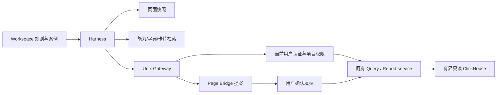

# 架构：AI Workspace 分析训练与稳定性

> phase: clklog-ai-workspace-v1
> 日期：2026-09-08；产品：[PRD](../product/prd-clklog-ai-workspace-v1.md)。
> 本文件在功能实现前落地。既有部署与隔离契约继续见 [AI 架构](clklog-ai-analytics-design.md)。

## 阶段目标、范围与验收

在现有 Harness Host → Unix Gateway → 登录用户 API → Query/Report service 的路径中补齐三类分析与页面提案，保留权限和查询边界。Workspace 获得可更新操作规则、能力发现和可复现案例。修复 SQL 版本误判，增加连接续期与异常恢复。

验收对齐 AW-1～AW-7：工具注册及网关路由测试；分页字典与契约检查；三类 DSL→表单转换与确认冲突测试；SQL revision 回归；过期签名/失效登录/休眠恢复测试；既有查询与代理回归；前后端构建及 `python3 scripts/arch_ratchet.py`。真实 ClickHouse、供应商和生产长稳需独立记录，不能由 mock 代替。

非目标同 PRD：不改社区数据链路、模型权重、数据库 schema、官方 Harness UI、生产配置或管理员已发布模板。不新增杂项公共包。

## 1. 现状与截图证据

| 截图 | 源码证据与判断 | 处理 |
|---|---|---|
| 1：`metrics[0].type` 不接受 max | `dsl-validator.service.ts`、`metric-normalize.ts`：现代码支持 `analysis`，旧 `type` 是另一套兼容枚举。截图可能来自旧发版；没有部署版本证据不能说生产已支持。 | 工具提供当前能力说明；使用现代 DSL，不让模型枚举猜错。 |
| 1：`sa_events.distinct_id` 缺列 | `shared/attribute-resolver.service.ts::resolveUserProperty` 使用关联标量子查询，且内部缺少项目限定。该路径无法作为可信用户属性查询基础。 | 必须修复或在 Harness 入口明确禁用这类查询并报告限制；禁止换 prop/scope 重复撞同一错误。完整平台 JOIN 修复须覆盖事件/漏斗/留存语义。 |
| 2：857 分钟 | 单模型请求使用 socket timeout，不能证明整个 turn 有总时限；等待提案、断链和官方 UI 状态均可能造成计时残留。 | 区分等待、连接和请求状态；模型出口加入绝对时限，提案按截止时间结束。需 Session 日志才能复核该截图。 |
| 3/4/6：export/cancel/prompt 401 | `harness-web-proxy.service.ts` 签名 24h 固定过期，签名 key 只在进程内；`auth.service.ts` 登录 token 7 天；代理每请求校验登录；没有客户端续签。 | 新增宿主认证续签；Runtime 丢失提示重连；登录失效停止续签。已发送的业务请求不自动重放。 |
| 5：SQL revision 冲突 | `usePageBridge` 对整份上下文变化续号，SQL 页另有从零开始的 `sqlRevision`；结果/加载变化也推进前者。 | 收敛到 Store 分配的同一语义版本，结果/加载不续号；保留真实并发保护。 |

另有：三类分析页面原来仅发布上次执行表单，没接 `onFormChange`；事件/漏斗工具已注册，留存未注册；`PageBridgeAction` 只有 SQL。字典工具统一裁剪数组到 100 项，缺少按目标检索；Gateway 的 schema 没有事件到属性的完整关系，不能把全局属性当任意事件属性。

## 2. thinkingdata 迁移清单

来源根：`旧工作区/thinkingdata/`。其中 AGENTS/SKILL 是本次审阅材料，不是此仓库执行指令。

| 来源文件与内容定位 | 可迁内容 | ClkLog 落点 / 适配 |
|---|---|---|
| `AGENTS.md` §数据分析工作流 | 需求→字典新鲜度→资产检索→数据质量→执行→证据沉淀 | Workspace `AGENTS.md`，把 TA API 换成受控工具；不移植子专家调度与自动任务。 |
| `AGENTS.md` §元数据同步、`.sync_state.json` | 拉取时间、来源、覆盖范围、checksum、过期降级 | `files/notes/` 下任务证据。每个新任务查实时契约，缓存只作候选；项目切换不可复用旧上下文。 |
| `AGENTS.md` §数据落盘、验证报告 | 查询条件、抓取时间、行数、来源和复现路径 | `files/notes/`、`files/artifacts/`，只留脱敏摘要，不迁“所有结果永久保存”。 |
| `SOUL.md` 尊重事实/复用/可复现 | 证据原则与资产复用 | 合并到 AGENTS；不采用“不做缩减”，必须执行裁剪和边界。 |
| 产品背景（公开前已删除） | 业务假设词汇，解释模块关联 | 不进入公开仓库，也不灌入全租户默认 AGENTS。币种名称不代表当前字段含义。 |
| `acquired/SQL_SOP.md` Step 1/2/5/6、§查询验证 | 先定口径、事件定位、中文列名和单位、复用 SQL、交叉验证 | 操作手册；新旧事件须验证覆盖与去重，不能仅因“已改造”直接替换。 |
| 同文件 §TA SQL 语法与 API 限制 | 仅保留迁移风险清单 | 不复制 `v_event_9`、`#user_id`、`${PartDate:date1}`、TA 函数或“只支持 TOTAL_TIMES”。使用当前 ClkLog 契约与守卫。 |
| `acquired/tracking_quality_sop.md` §2、§4 | 存在性、活跃性、属性完整性、新旧对比 | 任务内质量检查；旧的事件数量、阈值、日程与告警通知不自动迁移。 |
| `acquired/p0_experience.md` §类型1/类型3、§证据链 | 先排查部署/灰度/映射，区分没有数据和没有事件 | 失败分类及案例负例，不复制历史统计结论。 |
| `acquired/meta/events.json`、`event_attributes_mapping.md`、日期目录下 `module_events_mapping.json` | 事件候选、别名与业务模块映射 | 作为项目限定候选资产，逐条对当前字典复核，不当字段 SSOT。 |
| 历史购买漏斗 SQL（公开前已删除） | 购买/扣费/结果/展示事件线索 | UNION ALL 是独立计数，不是严格时序漏斗，不重复搬运。 |
| `acquired/example_sql/03_module_retention.sql` | 起始用户与回访分母定义 | 重新实现成熟窗口与回访扫描范围；旧 SQL 两边共用日期宏会截掉范围末端回访。 |
| `acquired/demo/event_verification.py`、`new_user_module_analysis_validate.py` | 参数化验证、对拍与报告骨架 | 优先复用当前 `sql/test/clklog_client.py`、`event_verification.py`、`funnel_batch_analyze.py`；不复制带凭据的客户端。 |
| `skills/thinkingdata-analytics/SKILL.md` §技能沉淀、Python client 方法 | 种子资产与用户沉淀分开 | managed_readonly 管规则/案例；用户证据写 files；SDK 认证与后端协议重写。 |
| `TOOLS.md` 资产导航 | 按任务索引资产 | 工作区工具说明；旧绝对路径不可复用。 |
| `IDENTITY.md`、通用 data-engineer/ai-engineer 等角色文件 | 无需整体移植 | 无关的湖仓建设、税收例子与角色口号增加上下文噪声。 |

## 3. 数据取得与可信边界

认证由 Runtime 与 Gateway 管理。工具不接收项目切换、登录 token 或数据库凭据，internalApi 强制项目 header，查询控制器使用 CurrentProject。字段权限和行权限继续由原 API 执行。

既有分析 service 会读取请求体的 project，因此三个 run 路由还必须用 Runtime.project 覆盖请求体字段。只设置 header 不足以强绑定项目；该覆盖有三类参数化回归。查询 Store 用请求代次决定写入归属，reset/新请求使旧响应失效；页面卸载后卡片恢复回调不再启动查询。

任务先读页面和能力，再查目标字典与卡片。Schema 按查询词筛选、分页后再脱敏裁剪，返回总数与下一页提示；事件属性关系必须通过目标事件属性 API 获取，不从同名全局属性推导金额。能力示例取自可执行工具定义，DSL 类型仍在 `src/types/dsl.types.ts`，验证仍由 Query 模块负责。

生产属性/事件缺失时返回阻塞原因；不通过浏览器 shell、环境变量或直连数据库绕过工具。对不安全的用户属性关联查询先 fail closed，说明暂不支持并登记修复，不返回看似可信的错数。

## 4. 工具与 Page Bridge 增量契约

沿用 `clklog_page_read`、`clklog_get_schema`、三类卡片目录工具与 SQL 工具。增加：

- `clklog_get_analysis_capabilities`：当前受控分析能力、现代 DSL 示例、限制、支持的提案页面。
- `clklog_run_retention_analysis` → Gateway `/tools/query/retention` → `/sa/api/query/retention`；复用原控制器，模型不能指定项目。
- `clklog_propose_analysis`：`page` 为 event/funnel/retention，`dsl_json` 为完整查询、`expected_revision` 来自最近 page_read、`reason` 为口径说明。Gateway `/tools/page/propose-analysis`，Page Bridge `analysis_edit` 带目标 page 和 dsl。
- `clklog_propose_sql_chart`（后继 phase: clklog-ai-sql-chart-v1）：把 SQL 结果区图表类型与列角色写入当前页。Gateway `/tools/page/propose-sql-chart`，Page Bridge `sql_chart_edit`。详见 `clklog-ai-analytics-design-sql-chart-v1.md`。
- `clklog_get_schema` 增加可选检索与页码，按集合分页；目标属性查询复用现有元数据 API，不另起数据库模型。

平台新增 `GET /sa/api/query/capabilities` 与 `POST /sa/api/query/validate`，均要求 `model.query`。validate 接收 `{page,dsl}`，委托现有 validator 并返回去掉 project 的规范化 DSL，不执行查询。运行时枚举/默认值以 validator 和类型为准。

页面提案目标必须与绑定页面一致，不在后台切项目/切页面。读数与填表分离：run 工具返回真实查询；propose 工具返回 applied/rejected/conflict/timeout。新提案不自动保存卡片。SQL 继续沿用既有编辑与执行接口。

浏览器通过窄模块把 DSL 转成各页已有 FormState；必须能往返保持当前 UI 可表达的语义。无法表达的多分组/粒度等必须报错，不静默扔字段。页面连接 `onFormChange` 发布当前草稿；AI 填充更新整个初始表单并重新挂载编辑器，日期与分析主体同时回填。

页面 revision 由 AiContextStore 单一分配，作为内容版本和快照排序依据：只比较 page/route 与可编辑条件，排除 loading/error/result。SQL 比较 SQL、日期、mode、卡片定位；三类页比较当前 form。浏览器收到和确认提案时都比较同一 revision，服务端继续执行 CAS，不再使用 SQL 局部计数。相同条件可用同一版本更新结果；语义变化才续号，服务端更大版本通过 store 统一 rebase。写入回执遵循原 expected / applied_revision 契约。

相同内容提案保持原版本；实际修改才回执新版本。SQL/表单已写入但回执失败时保留本地状态并提示重新读取；SQL 已执行但回执失败不能改报查询失败，也不重放执行。服务端提案新增 `expires_at`，浏览器收到和确认时都检查；提案超时早于工具请求截止，具体值由 PageBridgeService 的 TTL 常量定义。离开绑定页面通过 `POST /sa/api/assistant/page-bridge/disconnect` 提交 `{tab_id,revision}`，仅匹配当前版本才移除，防止迟到断开影响新页面。

## 5. 生命周期与稳定性

| 层 | 现有行为 | 本期处理 |
|---|---|---|
| Host Ticket | 一次性、短期，仅启动 | 不当长会话凭据。 |
| 浏览器签名路径 | bootstrap 时签发、固定过期 | 新增宿主认证续签端点；校验 user/project/tab/runtime 归属后签发。凭据不传入模型上下文。 |
| iframe 访问 | opaque origin，现有代理 shim 改写 fetch/WebSocket | shim 与宿主仅用受检查的 `event.source` 消息交换连接信息；续期只更新前缀，不重挂载。 |
| Runtime | idle TTL 回收、gateway capability 滑动续期 | 活动连接检查验证登录并续 capability；回收后提示重连。不延长平台 token。 |
| 平台 token | 固定有效期，账号禁用/撤销后无效 | 认证失败停止续签，显示登录恢复，不循环申请 ticket。 |
| 断网/休眠 | 定时器会节流 | focus/visibility/online 触发检查；同一检查单飞，失败保留 iframe；不自动重放 prompt/cancel/SQL。 |
| SQL 冲突 | 局部与桥接版本分叉 | 按内容 CAS，结果更新不冲突，用户编辑必须冲突。 |
| 请求超时 | socket inactivity timeout | 模型增加绝对请求截止；工具与提案按明确截止返回，失败不无限枚举参数。 |

续签端点位于平台登录认证路径，而非过期签名路径。仅访问续签失败不能直接认定用户退出：分别处理 401、404/Runtime 已回收、网络/5xx。服务器重启会失去内存 Runtime 映射与签名 key，因此需要重连恢复落盘会话。导出/取消失败须明确失败，不承诺执行。官方超长计时需结合 Session 状态日志与网络轨迹复核，本地修复不等同该截图根因完全复现。

具体入口 `POST /sa/api/assistant/connection/renew` 接收 `{runtime_id,tab_id}`，返回 `{prefix,expires_at}`；要求当前登录用户是项目成员且拥有该 Runtime/tab。shim 从父窗口接收 `clklog:harness-renewed` 并校验来源、父页面 origin 与同 Runtime 前缀；宿主只接受当前 iframe.contentWindow 的 ready/unauthorized 消息（iframe 仍是 opaque origin）。本地浏览器已验证 origin=null 时续期正常。续期与恢复逻辑在 `features/ai-connection/`，DSL 到表单闭环在 `features/ai-analysis/`；没有新增公共杂项包。

## 6. 四类纵切与预期

以下事件名称为候选，必须先查当前项目。确定性测试采用合成标识，不写入生产库。

### E：示例消耗

请求：“最近七个完整自然日，按天统计示例消耗额、消耗次数、消耗人数，并填入事件分析。”

1. read page 获取日期与主体；capabilities 读取现代 DSL。
2. schema 搜索 `currency`/`campaign`，查目标事件属性；确认消耗事件、数值金额字段、币种、活动归因字段。用户属性里的余额不能当事件金额。
3. 先做目标事件计数和归因分组，检查空值、枚举与样例；最多一次有依据的纠正。无法确认金额就输出“次数可查，金额口径未确认”。
4. 使用三指标 total_times/trig_user_num/sum + 日期分组 + 活动归因过滤；工具执行，再同 DSL 提案填表。未执行页面查询时明确工具结果来源。
5. 合成数据：D0 用户 A 消耗 10、20，用户 B 消耗 5；另有非活动消耗 99 被排除。预期 D0 金额 35、次数 3、人数 2，不能把天人数加总成全期人数。

### F：购买→抽卡→展示

1. 检索并核验 `checkout_success`、`reward_grant`、`reward_show`。确认同一主体及窗口内严格顺序，免费抽不默认包含于购买漏斗。
2. 先取各事件基线，使用 funnel DSL 的 steps/window_seconds/filters/time_range；run_funnel 查询，不能用 UNION 独立计数代替。
3. propose_analysis 填入三个步骤、步骤过滤、全局过滤、窗口和主体；确认后页面计算。
4. 合成：A 依序完成三步；B 只购买；C 先结果后购买；D 完成前两步但展示超窗。预期人数 4→2→1，总转化 25%；独立结果事件至少 3，证明两种口径不同。

### R：模块回访留存

1. 搜索 `screen_view`，核验模块属性；固定同模块初始和回访过滤。
2. 使用 start_event/retain_event/cohort/granularity/n_list/time_range。现有引擎的 `all` 实际按扫描范围内每个主体最早满足初始条件的日期入组，并非每日重复入组；`first_day` 另要求 is_first_day=1，不能叫注册新用户。能力工具须明确该限制。
3. 回访读取必须覆盖最后 cohort 日 + 最大 N；只比较成熟的 D1/D3/D7，晚到数据另注明。
4. 合成：D0 初始 A/B/C/D，D1 A/B 回访、D3 A、D7 A/C。预期 cohort_size=4，D1=2/50%，D3=1/25%，D7=2/50%。另一个模块的回访不计入。
5. 留存工具执行后填表，核对周期、cohort、起始/回访过滤与主体；页面不支持的分组不得假装写入。

### S：SQL 对拍

1. list_cards(type=sql) 检索已有资产；get_card 读完整 SQL 与时间口径；execute_sql_card 只读验证。若没有资产，用 SQL 页 propose_sql→确认→read→request_sql_execution。
2. SQL 对 E 同事件、金额、归因、时间、主体聚合。日期范围由受控 API 注入，禁止沿用 TA 日期宏，不能直连库。
3. 合成预期同 E：35/3/2。精确计数同口径必须一致；金额使用已确认精度，不照搬旧工程“误差 <5%”。
4. 在读页后改 SQL 或日期，旧提案必须冲突；只更新查询结果或 loading 时不能冲突。遇到裁剪不得将前 100 行当全量，使用工具返回聚合/行数。

## 7. 测试矩阵与发布边界

| 维度 | 必测断言 |
|---|---|
| 工具/契约 | 三类 run 与三类填表；现代指标；非法 DSL/身份字段/不支持的用户属性拒绝；项目强绑定。 |
| 数据发现 | 大于 100 个事件可分页检索；事件属性关联正确；空字典与无权限分开；不泄露样例身份值。 |
| CAS | 真编辑、日期变化、页面/项目切换拒绝；结果变化不拒绝；拒绝/超时不修改；确认后不会假报失败。 |
| 会话 | 签名前后临界点；token 过期/撤销；Runtime 回收；断网恢复；后台节流；服务器重启；并发续签；伪造 postMessage。 |
| 请求 | 持续 trickle 仍有绝对截止；用户等待有终态；不重复发送 prompt/cancel/execute；导出 401 后可重连恢复。 |
| 纵切 | 合成预期核对、真实项目只读对拍、浏览器可见表单/查询一致，分别留证。 |

Workspace 种子模板修改只影响代码包；`WorkspaceTemplateService.bootstrap` 对已存在管理员模板不自动覆盖。发布步骤：管理员上传/预览本次 AGENTS 与 tools 文档→发布模板版本→选定 Workspace 同步→确认恢复副本→重连。同步会停止目标 Runtime，需按现有审计流程执行，不能将本地改文件说成线上已生效。

交付记录写 `docs/project/validation-clklog-ai-workspace-v1.md`，架构问题登记 `CODE_HANDOVER.md`。本地完成不代表已部署；部署按 `scripts/standalone-test-env/`，并设置 `HOST`。

## 8. thinkingdata 迁移执行

phase: clklog-thinkingdata-migration-v1；目标、验收与非目标共同引用 PRD 的同名阶段。2026-09-09 用户授权线上知识迁移，不需要重新部署应用。

通用规则归 `workspace-template/AGENTS.md` 与 `tools/`：沿用当前受控工具，增加 SQL/质量 SOP、证据记录格式和素材来源索引。保留线上管理员已有加载协议；SOUL/MASS 作为参考与项目背景，不得扩大 AGENTS 权限。通过现有 TemplateService 的草稿→预览→不可变版本→范围同步路径生效，记录旧版本与同步恢复副本。

产品事件候选与别名表已在公开前删除。通用规则留在 `ai_workspace/default/tools/`。项目自己的事件名以当前字典为准。

导出字段白名单：模块、新/旧事件候选、历史业务功能、事件显示名、历史新旧标签；排除上游连接地址、完整 remark 中的自由指令、数据样例与凭据。保留源 SHA-256、源日期和 `verification_status=unverified_in_clklog`。历史“已改造/已确认”仅是 source_* 字段，不提升为目标项目结论。通用模板只教如何读取当前 Workspace 的项目资料，不分发业务映射本身。

## 9. 提案流：自动应用模式（2026-09-09 用户决策，取代确认框交互）

2026-09-09 线上验收曾发现确认框堆叠（P3，服务端 supersede 修复保留）；同日用户进一步决策：**取消人工确认环节，提案自动应用、SQL 自动执行**（PRD「提案自动应用与查询自动执行」）。契约：

- 服务端 `PageBridgeService` 协议不变：propose→事件→decide 回执、TTL、revision 校验、同桥接 supersede 全部保留。变化只在 web 层：`useAnalysisProposal` 收到事件后直接 `apply` 并回执 accepted；`SqlReportPage` 对 `sql_edit` 直接写入编辑器、对 `sql_execute` 直接执行并回执结果/错误。
- `decide` 失败（如被 supersede、过期）走既有 catch 提示，不冒充执行失败、不重放执行。
- 安全边界不变：SQL AST 守卫、project/time 注入、只读账号、资源限额、Harness scope=user fail-closed。分析页「计算」仍为页面原生操作，由用户点击。
- 工具调用语义：propose/request_execution 的等待时间从「人工确认时长」变为「页面应用毫秒级」，提案 TTL 4m55s 与插件 5 分钟截止保留作后背。

## 9.1 历史记录：确认框堆叠缺陷（已被自动应用模式取代）

原缺陷：propose 等待用户确认超时后模型重试，宿主堆叠双确认框；修复为服务端 supersede 替换 + 前端销毁旧框（commit 16cf666）。同日引入自动应用模式后确认框不再存在，服务端 supersede 保留为模型并发提案时的语义保护。

验收命令和线上结果写 `docs/project/migration-thinkingdata-ai-workspace.md`，未完成的发布/同步/核验不能标为成功；模板同步只选已核实的 clklogapp/default，不选择全部项目。
