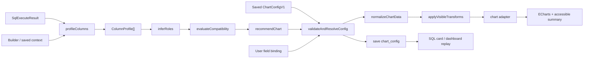

# 实现方案：自定义 SQL 结果可视化图表体系（v1）

> phase: `clklog-analytics-charts-v1`
> 版本：v1.0（2026-09-03）
> 状态：实现方案已就绪，待程序实现与验收
> 上游：`docs/product/prd-clklog-analytics-charts-v1.md`
> 关联：`docs/architecture/clklog-analytics-design-sql-report.md`、`docs/architecture/clklog-analytics-design-dashboard-sql-cards-v1.md`、`docs/architecture/code-hard-gates.md`
> 本文档是本 phase 的字段角色、图表配置、推荐算法、模块边界、持久化兼容和测试契约 SSOT。

---

## 0. Cursor 执行入口

实施前按以下顺序读取并执行：

1. 先读产品 PRD，确认用户行为、v1 范围和 `CHART-AC01..36`。
2. 再读本文，按 §15 的依赖顺序实现，不把后续图形带入 v1。
3. 产品行为冲突时以 PRD 为准；字段、配置、API、模块和算法冲突时以本文为准；现有代码只代表当前基线，不覆盖本 phase 已作出的设计裁决。
4. 若代码现实使本文契约不可实现，先在对应产品/架构文档中写明差异并获得确认，不得静默发明第二套配置或降低验收标准。
5. 每个实施块连同测试提交；全部完成后在 `docs/project/` 新增本 phase 验收记录，并附 §16 的本地、生产只读和红线证据。

`.impeccable/critique/` 下的快照只保留原稿评审证据，不是实现 SSOT；Cursor 应以上游 PRD 和本文为唯一实施输入。

---

## 1. 阶段目标与范围（程序门禁要素①）

### 1.1 目标

在不改变 ClickHouse 查询与安全链路的前提下，为 SQL/Builder 结果建立一套独立于 `g_`/`m_` 前缀的可视化内核，完成：

1. 类型感知的列画像与角色识别；
2. 唯一、可解释的默认图表推荐；
3. 图表兼容校验、数据规范化和可见变换；
4. 用户字段绑定与本地切换；
5. SQL 卡片图表配置的保存、恢复和看板复现；
6. 旧卡兼容、失败回退、性能和无障碍保障。

### 1.2 代码范围

| 层 | 范围 |
|---|---|
| Web 新包 | `apps/analytics-web/src/features/visualization/` |
| Web 接入 | `QueryResultPanel.tsx`、`SqlReportPage.tsx`、`CardWidget.tsx`、类型与 service |
| Web 兼容 | 现有 `components/ChartRenderer.tsx` 保持事件分析兼容，不把 SQL 逻辑塞回该文件 |
| Server 接入 | `report/dto/sql-report.dto.ts`、`sql-report.service.ts`、必要的窄职责配置校验器 |
| 测试 | Web 纯函数/组件测试、Server 保存兼容测试、浏览器 E2E、生产只读回归 |
| 文档 | 本文、PRD、README、INDEX、必要的验收记录 |

### 1.3 不变边界

- SQL execute 请求与响应结构保持兼容；继续返回 `columns[{name,type}]`、`rows` 和查询统计。
- 不修改 SQL AST 守卫、`additional_table_filters`、只读账号、项目/时间注入和 ClickHouse 限额。
- 图表切换与绑定只处理已经返回浏览器的数据，不触发额外查询。
- 不新增 Prisma 模型、字段或 migration；配置继续存入 SQL 卡片的 `dsl_json.chart_config`。
- 不修改社区版表和旁路库表。

---

## 2. 架构验收标准（程序门禁要素②）

- [ ] **ARCH-CHART-01**：列分类、兼容判断、推荐和变换均为无 React、无网络、无环境变量读取的纯函数。
- [ ] **ARCH-CHART-02**：SQL 可视化不再依赖 `g_`/`m_`；事件分析现有 `ChartRenderer` 行为不回归。
- [ ] **ARCH-CHART-03**：每次推荐最多返回一个默认图；任何不确定/冲突返回结构化 issue 并回退表格。
- [ ] **ARCH-CHART-04**：NULL 不转 0，时间不隐式补桶，自由 SQL 不做二次聚合。
- [ ] **ARCH-CHART-05**：多行漏斗没有 `row_selector` 时不得生成 series；UV/比率不得跨行累加。
- [ ] **ARCH-CHART-06**：`ChartConfigV1` 经服务端白名单和大小校验后保存；任意 ECharts option、函数和脚本被拒绝。
- [ ] **ARCH-CHART-07**：配置保存、覆盖、详情、看板刷新端到端复现；旧卡无配置继续显示表格。
- [ ] **ARCH-CHART-08**：无效、缺列或未来版本配置不会使页面崩溃，返回 `STALE_CONFIG` / `UNSUPPORTED_CONFIG_VERSION` 并回退表格。
- [ ] **ARCH-CHART-09**：总点数、系列、类别和步骤上限在进入 ECharts 前统一检查，不静默采样。
- [ ] **ARCH-CHART-10**：分析页与看板使用同一配置解析、数据适配和只读绘制内核。
- [ ] **ARCH-CHART-11**：测试覆盖 PRD CHART-AC01..36；45 张 SQL 卡的脱敏形状纳入 fixture/验收清单。
- [ ] **ARCH-CHART-12**：前后端 build/test/lint 与 `python3 scripts/arch_ratchet.py` 全部通过。

---

## 3. 非目标（程序门禁要素③）

- 不实现堆叠柱、通用热力、散点/气泡、留存矩阵、桑基、直方和箱线。
- 不重构事件/漏斗领域查询，不把专用漏斗结果改成通用 SQL 形状。
- 不实现看板内字段配置。
- 不允许客户端或数据库保存任意 `EChartsOption`。
- 不新增图表主题系统、双 y 轴、组合图、导出图片、下钻或联动。
- 不为了图表自动执行 SQL、改变 LIMIT、修改查询排序或增加后端聚合。
- 不扩大 `src/common/`、`src/modules/shared/`、web `src/utils/` 结构债。

---

## 4. 当前实现与差距

| 位置 | 当前行为 | 本 phase 处理 |
|---|---|---|
| `components/ChartRenderer.tsx` | 只支持 `line/bar/number`，按 `m_`/`g_` 找字段，NULL 转 0 | 保留为事件分析兼容壳；SQL 走新可视化包 |
| `features/report/QueryResultPanel.tsx` | 图表固定 `line`；本地透视只认少量英文别名 | 接入 `ChartWorkbench`，状态与配置受控 |
| `pages/Report/SqlReportPage.tsx` | 页面持有查询结果，但不持有/保存图表配置 | 成为 SQL 图表配置所有者，并参与 dirty/save/load |
| `types/report.types.ts` | `ChartType` 不含 SQL 漏斗；`chart_config` 只有松散 type | 引用/定义 `ChartConfigV1`，扩展白名单 |
| `sql-report.service.ts` | 可以存 `chart_config`，但前端未传；新 SQL 卡 `chart_type=table` | 校验并保存配置，同步冗余 `chart_type` |
| `CardWidget.tsx` | SQL 卡固定 Table；其他卡使用旧 renderer | SQL 卡使用只读 `ChartWorkbench`，其他类型不动 |
| 留存模块 | 前后端仍为 TODO | 明确排除，不让通用 SQL 图表猜留存语义 |

当前相关目录未达到结构上限；新增能力仍必须落在语义窄包，不继续膨胀 `QueryResultPanel` 或通用 `components`。

---

## 5. 总体架构



核心约束：

1. `ColumnProfile`、推荐结果、兼容 issue 和适配后数据都是显式中间产物，可测试、可审计。
2. 推荐器不直接生成 ECharts option；图表 adapter 只接收已验证的绑定和规范化数据。
3. UI 不从 ECharts option 反推业务配置。
4. 分析页和看板共用从 `validateAndResolveConfig` 到 renderer 的完整链路。

---

## 6. 公共类型与持久化契约

建议把共享 Web 类型放在 `features/visualization/chart.types.ts`，并在 `types/report.types.ts` 仅重新导出需要进入 API DTO 的类型。Server 按同一字段白名单定义 DTO/validator；不通过复制注释另起语义。

### 6.1 基础枚举

```ts
export const CHART_CONFIG_SCHEMA_VERSION = 1 as const;
export const CHART_RECOMMENDATION_VERSION = 1 as const;

export type ChartMode = 'auto' | 'manual';
export type ResultView = 'table' | 'pivot' | 'chart';
export type ChartTypeV1 = 'table' | 'number' | 'line' | 'bar' | 'pie' | 'funnel';
export type ColumnRole = 'time' | 'dimension' | 'metric' | 'ignored' | 'pending';
export type Confidence = 'certain' | 'probable' | 'pending' | 'invalid';
export type MetricUnit =
  | 'number'
  | 'ratio_0_1'
  | 'percent_0_100'
  | 'currency'
  | 'duration_ms'
  | 'duration_sec';
export type AggregationSemantics = 'additive' | 'non_additive' | 'unknown';
```

`bar` 通过 `orientation` 区分柱状/条形，`pie` 通过 `donut` 区分饼/环形，避免把纯视觉变体扩大为持久化 chart type。

### 6.2 列画像

```ts
export interface ColumnProfile {
  key: string;
  clickhouseType: string;
  baseType: 'time' | 'number' | 'string' | 'boolean' | 'array' | 'object' | 'unknown';
  role: ColumnRole;
  confidence: Confidence;
  reasons: ColumnReasonCode[];
  nonNullCount: number;
  nullCount: number;
  distinctSampleCount: number;
  metric?: {
    unit: MetricUnit;
    aggregation: AggregationSemantics;
    safeNumber: boolean;
  };
}
```

画像最多检查前 100 个非 NULL 样本，只用于分类和边界判断，不改变数据，不把“样本全数字”单独作为指标证据。

**SQL 聚合别名信号（2026-09-09 增补）**：数字列在名字正则（`METRIC_NAME`/`ID_NAME`）不命中时原判 `pending`，导致 DAU/DNU/DOU 这类自造缩写的聚合查询无法出图。增补确定性信号 `sql_aggregate_alias`：若执行结果携带来源 SQL，`profileColumns` 解析顶层 SELECT 列表中「聚合函数表达式 AS 别名」（支持反引号/双引号/方括号/裸中文别名，跳过子查询与引号内逗号），命中的数字列直接判 `metric`（confidence=certain）。SQL 经 `ProfilerContext.sql` 传入（SQL 页执行与结果面板均已接线）；无 SQL 上下文（看板回放等）行为不变。别名提取只读 SELECT 列表，不做 SQL 正确性判断，守卫与转义契约不受影响。

**旧卡片自动推荐（2026-09-09 增补）**：SQL 页 ChartWorkbench 的 resolveVisualization 此前未携带来源 SQL，旧卡片重新执行后画像仍 pending，推荐为空、保持明细表，手动「字段设置→应用配置」也会被同一画像证据压住。修复后 ChartWorkbench 全链路（主解析/恢复自动/字段面板）传入 SQL：旧卡片重新执行即按聚合别名获得推荐并自动应用（既有 `!config && recommended → onConfigChange` 通道），手动应用配置亦不再被驳回。

### 6.3 图表配置

```ts
export interface ChartConfigV1 {
  schema_version: 1;
  recommendation_version: 1;
  mode: ChartMode;
  preferred_view: ResultView;
  chart_type: ChartTypeV1;
  roles: Record<string, Exclude<ColumnRole, 'pending'>>;
  bindings: {
    x?: string;
    category?: string;
    series?: string;
    metrics: string[];
    ignored: string[];
    row_selector?: {
      column: string;
      value: string | number | boolean | null;
    };
    funnel?: {
      shape: 'wide' | 'long';
      metric_family: 'uv' | 'pv' | 'custom';
      steps: Array<{
        order: number;
        column: string;
        label: string;
      }>;
      long_shape?: {
        order_column: string;
        label_column: string;
        value_column: string;
      };
    };
  };
  options: {
    orientation: 'vertical' | 'horizontal';
    donut: boolean;
    sort?: {
      column: string;
      direction: 'asc' | 'desc';
    };
    top_n?: number;
    include_other: boolean;
    units: Record<string, MetricUnit>;
    aggregation: Record<string, AggregationSemantics>;
  };
}
```

约束：

- `roles` 和所有绑定 key 必须引用本次结果中的真实列；禁止 `__proto__`、`constructor`、`prototype` 等危险 key。
- `metrics` 最多 8 项；折线最多 5 项；漏斗 steps 3..8。
- `top_n` 仅允许 1..20。
- `row_selector.value` 仅允许 JSON primitive；字符串最多 256 字符。
- `label` 最多 100 字符。
- 整个 `chart_config` 序列化后最多 32 KiB。
- 不允许额外字段；服务端开启 whitelist + forbidNonWhitelisted 或等价显式验证。
- 不允许 formatter 源码、函数、HTML、任意 ECharts option 或 URL。

### 6.4 兼容 issue

```ts
export type ChartIssueCode =
  | 'NO_ROWS'
  | 'AMBIGUOUS_COLUMN_ROLE'
  | 'MISSING_TIME'
  | 'MISSING_DIMENSION'
  | 'MISSING_METRIC'
  | 'DUPLICATE_KEY'
  | 'TOO_MANY_SERIES'
  | 'TOO_MANY_ROWS'
  | 'TOO_MANY_POINTS'
  | 'TOO_MANY_METRICS'
  | 'NEGATIVE_VALUE'
  | 'ZERO_TOTAL'
  | 'NON_ADDITIVE_METRIC'
  | 'MIXED_UNITS'
  | 'UNSAFE_INTEGER'
  | 'MULTI_ROW_FUNNEL_REQUIRES_SELECTION'
  | 'ROW_SELECTOR_NO_MATCH'
  | 'ROW_SELECTOR_NOT_UNIQUE'
  | 'NON_MONOTONIC_FUNNEL'
  | 'STALE_CONFIG'
  | 'UNSUPPORTED_CONFIG_VERSION'
  | 'RENDER_ERROR';

export interface ChartIssue {
  code: ChartIssueCode;
  severity: 'info' | 'warning' | 'error';
  columns?: string[];
  params?: Record<string, string | number>;
}
```

业务逻辑只返回 code 和参数；用户文案集中映射，不在分类器、adapter 和组件中散落字符串。

### 6.5 推荐结果

```ts
export interface ChartCandidate {
  chartType: ChartTypeV1;
  compatible: boolean;
  config?: ChartConfigV1;
  reasonCodes: string[];
  issues: ChartIssue[];
}

export interface ChartInferenceResult {
  profiles: ColumnProfile[];
  recommended: ChartCandidate | null;
  candidates: ChartCandidate[];
  issues: ChartIssue[];
}
```

`recommended` 最多一个；`null` 表示回退表格。兼容候选的顺序固定，不能依赖对象遍历或 ECharts 默认行为。

---

## 7. 类型解析与列分类算法

### 7.1 ClickHouse 类型归一

先递归剥离以下 wrapper，再判断 base type：

- `Nullable(T)`
- `LowCardinality(T)`
- `SimpleAggregateFunction(name, T)`

分类：

| ClickHouse 类型 | base type |
|---|---|
| `Date`、`Date32`、`DateTime`、`DateTime64` | time |
| `Int*`、`UInt*`、`Float*`、`Decimal*` | number |
| `String`、`FixedString`、`UUID`、`IPv4`、`IPv6`、`Enum*` | string |
| `Bool` / `UInt8` 且明确 boolean 语义 | boolean |
| `Array`、`Tuple`、`Map` | array/object，不自动出图 |
| 其他 | unknown |

`UInt8` 默认仍为 number，只有 Builder 或别名明确指向布尔时才作为 boolean。

### 7.2 别名规则

所有规则大小写不敏感；中文直接匹配：

| 语义 | 示例规则 |
|---|---|
| 时间 | `day/date/hour/week/month/time`、`日期/时间/小时/周/月` |
| ID/编码维度 | `(^|_)(id|key|code|rank|order)$`、`ID/编号/编码/序号` |
| 类别维度 | `name/type/category/channel/platform/os/country/scene/room`、`名称/类型/渠道/平台/场景/房间/国家` |
| 指标 | `count/sum/avg/min/max/total/pv/uv/users/revenue/amount/duration`、`数量/次数/人数/用户数/收入/金额/时长/均值/事件量/浏览量/访问量/点击量` |
| 比率 | `rate/ratio/percent/_pct/_%`、`率/占比/转化率` |
| 非可加 | `uv/uniq/distinct/avg/rate/ratio/percent/quantile`、`用户数/人数/均值/率/占比/分位` |
| 货币单位 | `revenue/amount/income/收入/金额/充值额`；`UV/次数/事件量` 等计数别名即使列名含「充值」仍为 number |

规则只能增强或削弱类型证据，不能把无法解析为数值的列强行变成 metric。计数单位优先于货币猜测，避免 `点击充值UV` 与 `支付成功次数` 被判 `MIXED_UNITS`。

### 7.3 严格时间样本

- 只接受 ClickHouse time 类型，或严格匹配 ISO/业务支持格式后全部可解析的字符串。
- 支持格式：`YYYY-MM-DD`、`YYYY-MM-DD HH:mm:ss`、ISO 8601 带时区。
- 至少 2 个非 NULL 样本才用样本确认连续时间。
- 不使用 dayjs 宽松解析，不因“多数唯一”判断时间。

### 7.4 数值与安全整数

- 依据 ClickHouse numeric type 解析，包括 JSON 中以字符串返回的 Int64/UInt64/Decimal。
- 值必须完整匹配数值格式，禁止 `parseFloat('12abc')` 类宽松转换。
- 非有限值、超 `Number.MAX_SAFE_INTEGER` 整数标记 `UNSAFE_INTEGER`。
- NULL 保持 NULL，不参与 min/max、求和或占比，不转换为 0。
- v1 不引入 BigInt 到 ECharts；不安全整数只保留表格，并给出 SQL 转换建议。

### 7.5 决策伪代码

```ts
function inferRole(column, context): ColumnProfile {
  if (context.savedRole) return certain(context.savedRole);
  if (context.builderRole) return certain(context.builderRole);
  if (isClickHouseTime(column.type)) return certain('time');
  if (isStringLike(column.type)) return probable('dimension');
  if (isNumeric(column.type) && isIdLike(column.name)) return probable('dimension');
  if (isNumeric(column.type) && isMetricLike(column.name)) return probable('metric');
  if (isStrictTimeSample(column.values)) return probable('time');
  if (isNumeric(column.type)) return pending('pending');
  return pending('pending');
}
```

任何 `pending` 列如果会影响候选图所需槽位，候选不参与自动推荐。

---

## 8. 兼容、推荐与数据变换

### 8.1 执行顺序

1. `profileColumns(columns, rows, context)`
2. `applyExplicitOrSavedRoles(profiles, config)`
3. `detectFunnelShape(profiles, rows)`
4. `buildCandidates(profiles, rows)`
5. `evaluateCompatibility(candidate)`
6. `resolveSavedOrRecommend()`：合法保存配置优先，否则严格按 PRD §5.5 返回第一个兼容候选
7. `validateAndResolveConfig(saved/manual/recommended)`
8. `normalizeChartData()`
9. `applyVisibleTransforms()`
10. `adapter.toEChartsOption()` + `buildAccessibleSummary()`

### 8.2 不可变数据

- 任何排序、TopN、其他分组都在 rows 的复制上执行，不 mutate API result。
- 明细表始终使用原始 rows。
- adapter 返回 `{ option, summary, audit }`；`audit` 记录输入行数、输出点数和变换，不包含 SQL 或敏感筛选值。
- 当前页面默认请求 1000 行，但 Execute DTO 和显式 SQL `LIMIT` 可产生更大响应；`rows.length > 10000` 时直接返回 `TOO_MANY_ROWS` 并禁止出图，不截断或抽样，虚拟表格仍使用全部响应行。

### 8.3 折线

- key 为 `(x)` 或 `(x, series)`；重复 key 直接 `DUPLICATE_KEY`，不求和。
- x 轴按解析后的时间升序，显示格式由时间粒度推断。
- NULL 用 ECharts 空值表达为断点。
- 系列 ≤5，总点数 ≤5000，单系列 ≤1000。
- 多指标要求单位一致；混合单位返回 `MIXED_UNITS`。
- 数值轴不强制从 0 起；option 必须避免视觉夸大并在 tooltip/摘要显示原始值。

### 8.4 柱状/条形

- category key 必须唯一；重复直接 `DUPLICATE_KEY`。
- 1..4 个同单位指标。
- 类别 >15 时默认 `orientation=horizontal`；类别 >20 时才设置 `top_n=20`。
- TopN 默认按第一个指标降序，用户选择排序指标后持久化。
- NULL 排在非 NULL 后；同值使用原始行索引作稳定次序，不能依赖运行时 sort 稳定性。
- 数值轴必须包含 0；有负值时保留负轴域，不能把负值裁掉。
- 图表只显示 TopN，表格不裁剪；UI 显示输入/展示数量。

### 8.5 饼/环形

- 只接受 1 个 metric，值必须非负、总和 >0。
- metric aggregation 必须为 `additive`；`uv/uniq/avg/rate/ratio/quantile/unknown` 不兼容，除非用户显式把语义确认成 additive。
- 类别 ≤6 直接展示；7..50 使用 Top5 + 其他；>50 不兼容，先让用户筛选。
- “其他”只求和已确认 additive 的值。

### 8.6 指标卡

- 只读取单行中的 1..8 个 metric。
- 多行时必须有明确 `row_selector`，否则不兼容。
- 禁止沿行累加，避免 UV、均值和比率失真。
- 每项展示名称、格式化值和单位；完整原始值可经 focus/tooltip 和文本摘要获得。

### 8.7 漏斗

#### 宽表检测

列名正则只作为候选发现：

```text
^(?<order>[1-9][0-9]*)[.、_\-\s]+(?<label>.+?)(?<family>UV|PV)?$
```

要求：

- 至少 3 个、最多 8 个连续 order；
- 同一 family 内每个 order 恰好一个列；
- 所有步骤列均为安全数值；
- 一行时可自动推荐；多行时必须找到/显式绑定维度列并提供 `row_selector`。

#### 手动步骤

- 允许从 metric 列中选 3..8 项；order 由用户排序确定。
- 不允许重复列；label 默认取列名清洗结果。
- 排序同时支持拖动和上移/下移按钮。

#### 显式长表

- 长表不参与自动检测，只有用户显式绑定 `order_column`、`label_column` 和 `value_column` 后才兼容。
- 绑定后必须得到 3..8 个步骤；order 为唯一、可比较且连续的整数，重复 order 返回 `DUPLICATE_KEY`，不求和。
- 如果长表还包含分组维度，本期只支持一个取值唯一的 row selector；选择后仍有重复步骤则不兼容。

#### 数据规则

- 永远 `sort: 'none'`，不让 ECharts 按 value 排序。
- 负数为 error；NULL 为 error，不转 0。
- 后一步大于前一步产生 `NON_MONOTONIC_FUNNEL` warning，不改变顺序。
- 分母 0 的 conversion 为 null，展示 `--`。
- 多行无 selector 返回 `MULTI_ROW_FUNNEL_REQUIRES_SELECTION`，series 为空。
- selector 必须在当前结果中恰好命中一行；零行返回 `ROW_SELECTOR_NO_MATCH`，多行返回 `ROW_SELECTOR_NOT_UNIQUE`，均不得取首行。

---

## 9. UI 状态与组件边界

### 9.1 新包建议

```text
apps/analytics-web/src/features/visualization/
├── chart.types.ts
├── chart.constants.ts
├── column-profiler.ts
├── chart-compatibility.ts
├── chart-recommender.ts
├── chart-config.ts
├── chart-data.ts
├── chart-issues.ts
├── ChartWorkbench.tsx
├── ChartToolbar.tsx
├── FieldBindingPanel.tsx
├── AccessibleChartSummary.tsx
└── adapters/
    ├── line.adapter.ts
    ├── bar.adapter.ts
    ├── pie.adapter.ts
    ├── number.adapter.ts
    └── funnel.adapter.ts
```

这是建议边界，不要求文件名逐字一致；必须保持职责等价并遵守：

- `column-profiler` 不 import React/ECharts。
- `compatibility`、`recommender` 不生成 option。
- adapter 不推断角色、不访问 store、不读环境变量。
- `ChartWorkbench` 负责装配，不承载分类/转换规则。
- `FieldBindingPanel` 只编辑 `ChartConfigV1` 草稿。
- 单目录达到 24 个生产文件前必须评估拆包，不得超过硬门禁。

### 9.2 组件接口

```ts
interface ChartWorkbenchProps {
  result: SqlExecuteResult;
  config: ChartConfigV1 | null;
  queryContext?: {
    mode: SqlMode;
    builderDsl?: unknown;
  };
  displayMode: 'analysis' | 'dashboard';
  onConfigChange?: (config: ChartConfigV1) => void;
  onIssue?: (issues: ChartIssue[]) => void;
}
```

- `analysis` 可编辑、显示完整工具栏。
- `dashboard` 只读，只允许切到表格 fallback和“在 SQL 分析中编辑”。
- 组件必须有 error boundary，renderer 异常返回 `RENDER_ERROR`，不能拖垮整页。

### 9.3 状态所有权

`SqlReportPage` 是 SQL 图表配置的唯一写入方：

```text
server/card config ─┐
                    ├─> SqlReportPage.chartConfig ─> QueryResultPanel ─> ChartWorkbench
new result auto  ───┘                         └──────> save / overwrite DTO
```

- 加载卡片时读取 `dsl.chart_config`，校验后放入 page state。
- 新查询无配置时创建 auto resolved config。
- 保存配置无论 `auto` / `manual` 都优先复现；`auto` 表示配置来自推荐器并可被“恢复自动”替换，不表示每次刷新都允许换图。
- 保存的 `recommendation_version` 落后时保留原 resolved 配置并提示升级，只有用户确认后才按当前推荐器重算。
- 新结果与现有保存配置不兼容时，保留原配置副本，UI 回退表格并提示，不自动覆盖。
- 用户“应用配置”才写 page state，并标记 dirty。
- 保存成功后清除 chart dirty；失败保持 dirty。
- 不在 `QueryResultPanel` 内部隐藏持久化 state，避免保存拿不到真实配置。

### 9.4 加载与结果保留

- 首次查询显示 skeleton。
- 后续重新执行时保留上一次结果，覆盖 loading 状态并禁用保存，避免整块空白闪烁。
- 新结果返回后原子切换 result + inference；错误时保留上一次成功结果并显示错误，除非现有产品明确要求清空。

---

## 10. SQL 卡片持久化与 API 兼容

### 10.1 存储位置

继续使用现有 `Card`：

```json
{
  "mode": "sql",
  "sql_text": "SELECT ...",
  "dsl": null,
  "field_map": [],
  "chart_config": {
    "schema_version": 1,
    "recommendation_version": 1,
    "mode": "manual",
    "preferred_view": "chart",
    "chart_type": "bar",
    "roles": { "country": "dimension", "event_count": "metric" },
    "bindings": { "category": "country", "metrics": ["event_count"], "ignored": [] },
    "options": {
      "orientation": "vertical",
      "donut": false,
      "include_other": false,
      "units": { "event_count": "number" },
      "aggregation": { "event_count": "additive" }
    }
  },
  "time_range": { "start": "2026-08-27", "end": "2026-09-03" }
}
```

示例只说明形状；真实配置的 roles 必须覆盖所有参与绑定的列。

### 10.2 DTO 与服务

- `SaveSqlReportDto.chart_config` 从 `unknown` 改为经过嵌套 DTO 或专用 validator 校验的 `ChartConfigV1 | null`。
- `save` / `update` 校验 schema、白名单、长度、步数和 top_n。
- `Card.chart_type` 作为目录展示和旧接口兼容的冗余字段，同步为 resolved `chart_type`；条形仍写 `bar`，环形仍写 `pie`。
- `cardToDetail` 返回完整 `chart_config`，未知/非法 JSON 返回 null 并记录 warning，不把原始异常对象直接发给前端。
- `getCard` / Dashboard detail 已携带 `dsl`，无需新增 API；前端从 SQL card DSL 读取 config。
- 若 `chart_config=null`，SQL 卡继续 `chart_type=table`。

### 10.3 Card chart type 白名单

前后端统一：

```ts
type CardChartType = 'line' | 'bar' | 'table' | 'number' | 'pie' | 'funnel';
```

本 phase 不把 `auto`、`horizontal_bar`、`donut` 写入 `Card.chart_type`；它们分别由配置的 mode/orientation/donut 表达。

### 10.4 旧卡与未来版本

| 输入 | 行为 |
|---|---|
| SQL 卡无 `chart_config` | 保持表格，不自动改变看板 |
| 旧 `{chart_type:'line'}` | 在分析页可读为 legacy suggestion，但未保存前不自动升级 |
| v1 `mode=manual` 配置合法 | 按保存配置复现 |
| v1 `mode=auto` 且推荐版本一致 | 按已保存 resolved 配置复现，不因刷新换图 |
| v1 `mode=auto` 且推荐版本落后 | 保持旧图并提示可升级；用户确认后才重新推荐和保存 |
| v1 缺列/类型变化 | `STALE_CONFIG`，表格 fallback，保留原 config |
| `schema_version > 1` | `UNSUPPORTED_CONFIG_VERSION`，表格 fallback |
| JSON 损坏/超限 | Server 拒绝新保存；读取历史坏值时置 null + 日志，不抛 500 |

不做数据库 migration，因此旧版本应用回滚时仍能忽略 `dsl_json.chart_config`；这是本 phase 的回滚基础。

---

## 11. 看板接入

`CardWidget` 的分支调整：

```text
card.type === 'sql'
  ├─ refresh 返回 SqlExecuteResult
  ├─ chart_config 合法 → ChartWorkbench(displayMode='dashboard')
  ├─ chart_config 缺失 → Table
  └─ chart_config 失效/渲染失败 → warning + Table

card.type !== 'sql'
  └─ 保持现有 Event/Funnel ChartRenderer 路径
```

要求：

- SQL 看板卡不再无条件 Table，但不能出现编辑字段入口。
- 看板宽高变化触发 ResizeObserver；组件卸载时清理 observer 和 ECharts instance。
- 卡片过窄且无法表达当前图时不猜测新的图形，显示已保存图形的可读 fallback。
- “在 SQL 分析中编辑”沿用 `/report/sql?card=<id>`。
- 看板 refresh 仍走原服务；配置不参与 SQL execute，不允许影响安全守卫。

---

## 12. 可访问性、布局与渲染约束

### 12.1 ECharts option 基线

所有 adapter 必须注入：

- `aria.enabled=true` 与有意义的 description；
- 统一 tooltip 数字格式；
- 适配容器的 grid/legend；
- animation 时长 150..250ms；`prefers-reduced-motion` 时关闭；
- 折线系列超 2 条时使用 symbol/lineStyle 辅助区分；
- 漏斗 `sort:'none'`；
- 不使用渐变、玻璃、装饰动效或仅颜色表达状态。

### 12.2 文本摘要

`AccessibleChartSummary` 至少包含：

- 图表标题/类型；
- 使用的维度和指标；
- 数据点、系列、截断和 TopN 状态；
- 最大/最小或漏斗首末值与转化率；
- 当前 warning。

摘要可视觉折叠，但必须被读屏读取；原始表格通过视图切换始终可达。

### 12.3 容器

- `QueryResultPanel` 不写死互相冲突的高度。
- 结果区由页面级 Splitter 或等价组件控制，默认 360px，min 240px，max 70vh。
- 提供键盘可调整 separator，或显式“展开结果/收起结果”按钮。
- `ChartWorkbench` 使用 `ResizeObserver`，requestAnimationFrame 合并 resize；unmount 清理。
- `<960px` 的布局不并排挤压 SQL 编辑器和图表，结果可全屏。

---

## 13. 性能与安全预算

### 13.1 前端预算

| 项目 | 上限/策略 |
|---|---|
| profile 样本 | 每列最多 100 个非 NULL 值 |
| 表格 DOM | >200 行启用虚拟滚动；使用全部返回行 |
| 图表输入行 | ≤10000；超过返回 `TOO_MANY_ROWS`，不抽样 |
| 折线 | 每系列 ≤1000，总点数 ≤5000，系列 ≤5 |
| 柱/条 | metrics ≤4，展示类别 ≤20 |
| 饼/环形 | 原类别 ≤50，展示 ≤6 |
| 指标卡 | ≤8 |
| 漏斗 | 3..8 steps，单次只展示一行 |
| 配置 JSON | ≤32 KiB |
| 推荐/转换 | 目标为 1000 行 × 30 列下主线程同步处理 <50ms；10000 行边界需有性能证据 |

不引入静默抽样。达到上限时返回 issue，由 UI 引导缩小 SQL/时间或选择表格。

### 13.2 安全

- 图表配置不拼入 SQL，不传给 ClickHouse。
- 不执行配置中的字符串，不支持 formatter 函数和 HTML。
- tooltip/label 使用 ECharts 文本配置，禁止 `dangerouslySetInnerHTML`。
- 列名和标签按普通文本渲染，防止 XSS。
- Server 保存时限制 key、长度、数组大小和总 JSON 大小，拒绝 prototype pollution key。
- 错误日志记录 issue code、card id、列名，不记录完整 SQL 或业务筛选值。

---

## 14. 测试设计

### 14.1 Web 纯函数测试

建议测试文件：

| 测试 | 必测断言 |
|---|---|
| `column-profiler.spec.ts` | wrapper type、日期严格解析、数字 ID、中文/英文指标、NULL、安全整数、置信度 |
| `chart-recommender.spec.ts` | 决策顺序唯一、fallback、5 系列边界、饼不默认、保存的 auto/manual 配置优先、推荐版本升级不静默 |
| `chart-compatibility.spec.ts` | 重复 key、混合单位、非可加饼、负数、点数上限、多行漏斗 |
| `chart-data.spec.ts` | 不 mutate、NULL 不转 0、时间排序、TopN 审计、“其他”仅可加 |
| `funnel.adapter.spec.ts` | N. 列、显式长表、UV/PV、连续步骤、selector 零/单/多匹配、非单调、零分母、sort none |
| `chart-config.spec.ts` | v1 校验、missing column、future version、危险 key、大小上限、legacy fallback |

### 14.2 Web 组件测试

| 测试 | 必测行为 |
|---|---|
| `ChartWorkbench.spec.tsx` | 自动原因、兼容/禁用项、恢复自动、error boundary、摘要 |
| `FieldBindingPanel.spec.tsx` | 字段角色、必填槽位、应用/取消、键盘排序、错误定位 |
| `QueryResultPanel.spec.tsx` | loading/empty/error/truncated/TopN/保留表格、不重查 |
| `SqlReportPage.chart-config.spec.tsx` | load/save/overwrite/dirty/失效回退 |
| `CardWidget.sql-chart.spec.tsx` | SQL 保存图复现、旧卡 table、失效 table、编辑链接 |

通过 mock `echarts-for-react` 验证 option 和 props；关键 ECharts 真实渲染留给浏览器测试。

### 14.3 Server 测试

扩展或新增：

- `sql-report.service.spec.ts`
  - save 写入 `dsl_json.chart_config`；
  - update 未传 config 时保留，显式 null 时清除；
  - `Card.chart_type` 与 resolved type 同步；
  - cardToDetail 返回 v1；坏 JSON 不 500；
  - 旧卡无 config 行为不变。
- `chart-config.validator.spec.ts`
  - 非白名单字段、任意 option、超长 label、超多 steps/top_n、危险 key、未来版本被拒绝；
  - 完整 line/bar/pie/number/funnel/table 配置通过。

### 14.4 数据形状 fixture

至少包含：

1. `day + event_count`；
2. `hour + count()`；
3. `日期 + 活跃用户数 + 发布次数 + 发布率_%`；
4. `country + count()`；
5. `场景ID(String) + 用户数`；
6. `error_code(UInt32) + 次数`；
7. 单行多指标；
8. 单行四步 UV/PV 漏斗；
9. 50 行场景 × 四步 UV/PV 漏斗；
10. 非单调漏斗；
11. NULL、Decimal、UInt64 字符串和超安全整数；
12. 重复 `(time,series)`；
13. 截断结果；
14. 1000/10000/10001 行、5000 点和超 5000 点边界；
15. 旧 `{chart_type:'line'}` 和无配置 SQL 卡。

从生产 45 张卡提取 fixture 时只保留列名、类型和脱敏样本，不写入 SQL 全文、项目秘密或敏感筛选值。

### 14.5 浏览器 E2E

1. 登录，进入 SQL 分析页。
2. 执行趋势 SQL，确认自动折线和推荐原因。
3. 改柱状、调整字段、保存，确认没有第二次 execute。
4. 重开卡片，确认配置复现。
5. 加入看板并刷新，确认与分析页一致。
6. 执行内部场景多行漏斗，确认必须选场景且不求和。
7. 模拟缺列配置，确认表格 fallback。
8. 960px 与 200% 缩放，完成键盘主流程并检查 axe/ARIA。

---

## 15. 实施拆分与依赖顺序

每步完成测试后再进入下一步，不把所有图形堆进一个提交：

1. **契约与纯函数**：types、type parser、column profiler、issue codes、fixtures。
2. **兼容与推荐**：唯一决策表、line/bar/pie/number compatibility、数据规范化测试。
3. **分析页工作区**：`ChartWorkbench`、toolbar、字段设置、结果区 resize、状态文案。
4. **基础 adapter**：line、bar、pie、number，接入 SQL result。
5. **漏斗闭环**：宽表检测、UV/PV、row selector、非单调和无障碍。
6. **持久化**：Server validator、save/update/load、dirty state、legacy fallback。
7. **看板复现**：SQL `CardWidget` 使用只读 workbench，尺寸与 fallback。
8. **全量验证**：单测、组件测试、E2E、45 卡只读回归、文档和验收记录。

结构要求：

- 不向基线中的 `common/shared/utils` 增加新功能。
- `QueryResultPanel` 只负责结果视图编排，不承载算法。
- `SqlReportPage` 只拥有 state 和保存装配，不实现图表规则。
- 若单目录达到 24 个生产文件或 6400 行，先拆包再继续。

---

## 16. 验证命令与交付证据

### 16.1 本地

```bash
cd apps/analytics-web
npm test -- --run
npm run lint
npm run build

cd ../analytics-server
npm test -- --runInBand
npm run lint
npm run build

cd ../..
python3 scripts/arch_ratchet.py
```

如果现有脚本参数不同，以各 `package.json` 已登记命令为准，不为了文档命令修改测试框架。

### 16.2 部署后

- 浏览器完成 §14.5 E2E 并留截图/日志。
- 对生产 45 张 SQL 卡逐张只读 execute，记录 card id、列形状、推荐/保存图形、warning、耗时和结果。
- 重点复核挂在“场景”看板中的 SQL 卡。
- 明确记录：未修改 SQL 守卫、项目过滤、时间限制、ClickHouse 表和数据。

### 16.3 PR 声明

```text
phase: clklog-analytics-charts-v1
红线未自动检：
- 图表字段业务语义是否符合真实分析口径
- 45 张生产 SQL 卡是否覆盖全部数据形状
- ECharts Canvas 的实际读屏体验
- 960px / 200% 缩放与真实看板尺寸
- SQL 图表与原始表格数值的一致性
```

---

## 17. 回滚与失败策略

- 无数据库 migration，旧前端可忽略 `dsl_json.chart_config`。
- 配置解析、推荐或 renderer 任一失败均回退表格，不影响查询结果。
- 看板 SQL 卡渲染失败时仍可显示原有 Table。
- 不删除旧 `ChartRenderer`，事件分析不与 SQL 图表同时迁移，降低回归面。
- 若生产发现语义误判，优先停用该候选的自动推荐，保留手动选择与表格；不得通过静默改数据修复。

---

## 18. Definition of Done

满足以下全部条件才能宣称完成：

1. 产品 CHART-AC01..36 和架构 ARCH-CHART-01..12 全部通过。
2. `ChartConfigV1` 是唯一持久化图表配置，不存在第二套字段/option 权威。
3. 分析页、保存重开和看板复现使用同一内核。
4. 自由 SQL 不依赖 `g_`/`m_`，且不静默聚合或把 NULL 转 0。
5. 45 张生产 SQL 卡只读回归无错误图、无页面崩溃、无跨行 UV/比率聚合。
6. build/test/lint/arch ratchet 通过，验收证据写入 `docs/project/`。
7. 重新评审达到 Nielsen ≥32/40，且无 P0/P1。
